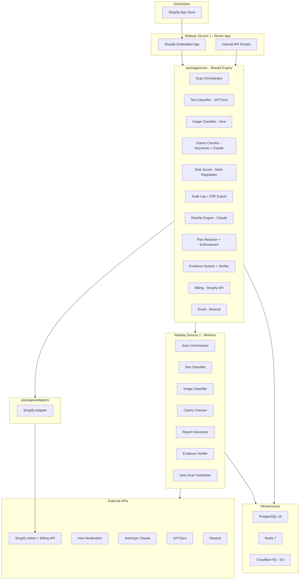
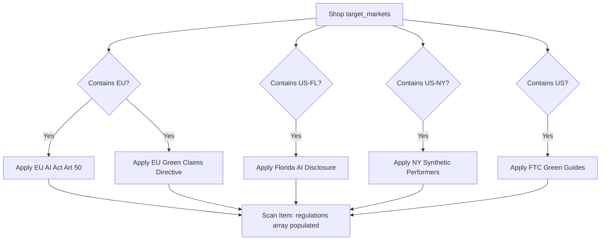
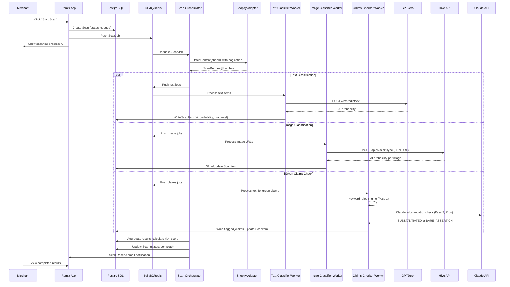
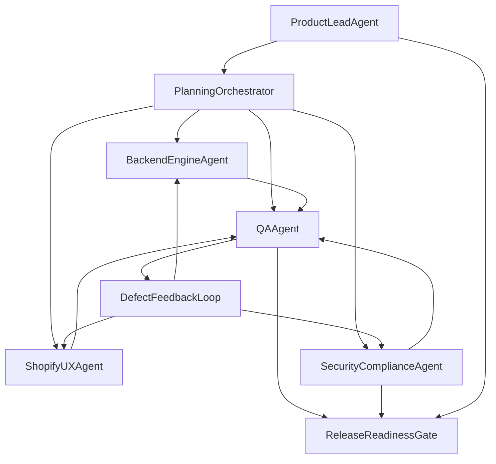
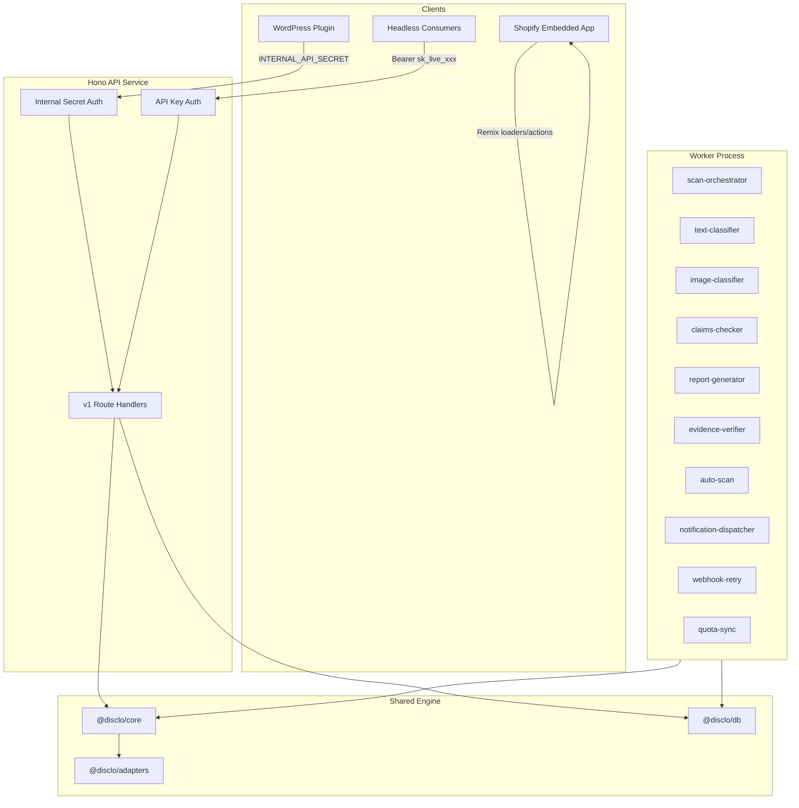

# Disclo — Authoritative Execution Plan

**Supersession.** This document is the **only** execution plan you need. Older Cursor plan files (validation v3, restructure, holistic draft) are **archives**; if they disagree with this file, **this file wins**.

**Key decisions (single answer per topic).**

- **Workspace root:** `c:\Dev\disclo-apps`. **Monorepo (pnpm) root:** `c:\Dev\disclo-apps\disclo`.
- **Shopify app path:** `disclo/apps/embedded/shopify/` — the only correct path.
- **Postgres:** Supabase. **Redis:** Upstash. **Non-Shopify billing:** Dodo Payments. **Shopify billing:** Shopify Billing API.
- **Railway services — Phase 1:** two — `shopify-app` (Remix SSR) and `workers` (all BullMQ workers). The `api` (Hono) service is added in Phase 2.
- **Hono API:** Phase 2. Internal API routes live inside Remix loaders/actions in Phase 1 only.
- **Notifications — Phase 1 vs Phase 3:** Phase 1 = `notifications` table + dispatcher worker + Resend email + lightweight in-app surfacing (poll/toast). Phase 3 = full **inbox UI** in the central app (same table).
- **Schema:** Prisma holds domain tables plus Shopify OAuth `**Session`** storage (`@@map("Session")`). Workspace layout tree: Appendix A `## 1. Workspace Layout Restructuring`.

---

# Disclo — Validated Execution Plan (v3)

---

## PHASE 1: VALIDATION REPORT

### 1.1 Critical Corrections from v2

**Correction 1: Shopify launches feature-complete**

Phase 1 delivers a complete, sellable Shopify app with ALL features:

- Text detection (GPTZero) + Image detection (Hive)
- Green claims keyword checker + LLM substantiation (Claude)
- Rewrite engine (Claude)
- Evidence system (all 6 evidence types, linking, suggestion engine)
- Audit log with PDF export
- Risk scoring with compliance score
- Disclosure badge (Theme App Extension)
- Editorial exemption
- All plan tiers (Free / Basic / Pro / Agency) via Shopify Billing
- Monthly auto-scan
- Email notifications (Resend)
- Shop settings (badge customization, green badge tooltip)

Other platform integrations (WooCommerce, WordPress, Headless API, website) move to Phase 2+. It is better to ship one complete product on one platform than a half-built product on three.

**Correction 2: All database tables created upfront**

Every table from the requirements doc is created in the initial Prisma schema and migration — including `users`, `auth_pass`, `auth_identities`, `plans`, `plan_overrides`, `shops`, `scans`, `scan_items`, `audit_log`, `api_keys`, `notifications`, `webhook_endpoints`, `webhook_deliveries`, `evidence_items`, `claim_evidence`, `certification_registry_configs`, and `shop_settings`. Tables not actively used in Phase 1 (e.g., `api_keys`, `webhook_endpoints`) simply remain empty until their features are built. No schema debt.

**Correction 3: All 5 regulations covered**

The system must detect and cite violations under all applicable regulations, not just the EU AI Act:


| Regulation                         | Detection Mechanism                                   | Output                                                                                   |
| ---------------------------------- | ----------------------------------------------------- | ---------------------------------------------------------------------------------------- |
| EU AI Act Article 50               | Text classifier (GPTZero) + Image classifier (Hive)   | Consumer-visible disclosure badge + machine-readable meta tag                            |
| Florida AI Disclosure Law          | Same text + image classifiers                         | Same badge mechanism, different regulatory citation                                      |
| New York Synthetic Performers      | Same image classifier (synthetic performer detection) | Same detection + badge                                                                   |
| FTC Green Guides (16 CFR Part 260) | Green claims keyword checker + LLM substantiation     | Merchant-facing remediation tasks only — never consumer badge for unsubstantiated claims |
| EU Green Claims Directive          | Same green claims checker                             | Same as FTC handling                                                                     |


**Schema implication**: `scan_items.regulation` must be `TEXT[]` (array), not `TEXT`. A single product description can trigger multiple regulations simultaneously (e.g., an AI-generated product description with a green claim triggers both EU AI Act Article 50 AND FTC Green Guides).

**Risk scoring implication**: The risk scorer must consider all applicable regulations. A product flagged under EU AI Act (high risk) AND FTC Green Guides (unsubstantiated claim) has compounded compliance risk.

**Badge implication**: The disclosure badge must cite the correct regulation(s). For EU merchants: "EU AI Act Article 50". For US merchants selling to EU: both EU AI Act and applicable US state laws. The `shop_settings` table should include a `target_markets TEXT[]` field (e.g., `['EU', 'US-FL', 'US-NY']`) that determines which regulations apply.

**Dashboard implication**: The fix dashboard must group issues by regulation so merchants understand which obligations they're addressing.

### 1.2 Schema Fixes Applied

All fixes from v2 remain, plus:

- `scan_items.regulation`: Change from `TEXT` to `TEXT[]` (array of applicable regulations)
- `shop_settings`: Add `target_markets TEXT[]` (determines which regulations apply to this shop)
- `shops`: Keep `owner_user_id UUID FK -> users(id)` as defined in requirements. The `users` table exists from day one. During Shopify OAuth install, a minimal `users` record is created with the merchant's email. Full user management (login flows, password, MFA) is Phase 3 (central app).
- All tables from requirements doc created in initial migration — no deferrals

**User record creation in Phase 1**: When a Shopify merchant installs the app, the OAuth flow:

1. Creates a `users` record with `email` from Shopify shop owner email, `email_verified: true`
2. Creates an `auth_identities` record with `provider: 'shopify'`, encrypted access token
3. Creates a `shops` record with `owner_user_id` pointing to the new user
4. The `auth_pass` record is NOT created (no password — Shopify handles auth)
5. Shopify OAuth **offline/online session** rows use Prisma `**Session`** (`@@map("Session")`) via `@shopify/shopify-app-session-storage-prisma`; App Bridge handles **browser** session UX

This means the `users` table is populated from day one, and the Phase 3 central app workstream adds Lucia auth, `auth_pass` records for direct login, and session management. No user data migration needed from Phase 1 Shopify installs.

### 1.3 Completeness Gaps Resolved

**All gaps from v2 are resolved. Additional items:**

- **Notification UI**: Full **notification inbox** UI is Phase 3+ (central app). **Phase 1 still requires** the `notifications` table to be populated, **email** delivery via Resend, **in-app surfacing** via lightweight polling/toast patterns in the embedded app, and a **notification dispatcher worker** (see Appendix A `## 7. Notification System (Phase 1 — Required)`). The central app inbox later reads the same table.
- **Product website**: Phase 2. Does not block Shopify launch.
- **Video/audio detection**: Out of scope until Phase 5+. Documented as a known limitation.
- **Multi-language**: English-first. Non-English text gets "manual review recommended" flag.
- **GDPR DPA**: Legal task, must be drafted before Shopify App Store submission.

### 1.4 Ambiguity Resolutions


| #   | Resolution                                                                                                                                                                           |
| --- | ------------------------------------------------------------------------------------------------------------------------------------------------------------------------------------ |
| A1  | `users` table created from day one. Minimal record on Shopify install. Full auth flows in Phase 3 (central app).                                                                     |
| A2  | **Two Railway services** in Phase 1: `shopify-app` (Remix SSR) and `workers` (BullMQ). **Hono `api` service** is Phase 2. Remix loaders/actions hold internal API routes until then. |
| A3  | Shopify Billing: `shops.plan_id` updated on `APP_SUBSCRIPTIONS_UPDATE` webhook.                                                                                                      |
| A4  | **App Block** (Online Store 2.0) for Shopify Theme App Extension.                                                                                                                    |
| A5  | Free tier: summary results page with flag counts + upgrade CTA. No fix dashboard.                                                                                                    |
| A6  | Rewritten content returned ephemerally. No draft storage table.                                                                                                                      |
| A7  | `shop_settings` table with badge text, green badge tooltip, target_markets, notification preferences.                                                                                |
| A8  | WordPress plugin: Phase 2. Hybrid — lightweight WP admin status widget + redirect to hosted dashboard.                                                                               |
| A9  | Pro = 1 shop, Agency = 3 shops, Enterprise = unlimited.                                                                                                                              |
| A10 | Content hash = SHA-256 of body/description text only.                                                                                                                                |
| A11 | `scan_items.regulation` is `TEXT[]` — supports multiple simultaneous regulations per item.                                                                                           |
| A12 | Regulation applicability determined by `shop_settings.target_markets`. Default: `['EU']` for all shops.                                                                              |


### 1.5 Scope Decisions

**Phase 1 — Feature-Complete Shopify App**

Everything needed to sell and deliver value on Shopify:

- All classifiers (text, image, green claims keyword + LLM)
- Rewrite engine
- Evidence system (all 6 types, linking, suggestion, verification worker)
- Audit log + PDF export
- All plan tiers (Free / Basic / Pro / Agency) via Shopify Billing
- Disclosure badge (Theme App Extension) with multi-regulation citation
- Editorial exemption
- Monthly auto-scan
- Email notifications
- Shop settings
- Risk scoring with multi-regulation awareness
- R2 document uploads for evidence

**Phase 2 — Multi-Platform + Public API + Website**

- WooCommerce/WordPress adapter + PHP plugin
- Headless REST API (Hono)
- Dodo Payments billing (non-Shopify platforms)
- API key management
- Outbound webhook system
- Product website (disclo.com)
- Quota sync worker

**Phase 3 — Central App + Scale**

- Central dashboard (app.disclo.com)
- Full user management (Lucia Auth, login, registration, password reset, email verification)
- Team members + roles
- Notification inbox UI
- Multi-store agency dashboard
- Social OAuth (Google, Facebook, Microsoft)
- MFA/TOTP

**Phase 4+ — Additional Platforms**

- BigCommerce, Wix, Webflow, Ghost adapters
- Multi-language AI detection
- Video/audio detection

### 1.6 Risk Register


| Risk                                                      | Impact | Likelihood | Mitigation                                                                                                    |
| --------------------------------------------------------- | ------ | ---------- | ------------------------------------------------------------------------------------------------------------- |
| GPTZero accuracy on short text (<100 words)               | High   | High       | Minimum 50-word threshold. Below = "insufficient text, manual review recommended". Test against known corpus. |
| GPTZero rate limit (10 req/sec) blocking concurrent scans | Medium | Medium     | Per-shop scan queuing in BullMQ. Use batch endpoint for stores >100 products.                                 |
| Shopify App Store rejection                               | High   | Medium     | Follow review checklist strictly. Test on 3+ dev stores. Allow 2-week buffer.                                 |
| EU AI Act interpretation uncertainty                      | Medium | Medium     | Position as "compliance infrastructure" not "legal guarantee". Disclaimers in ToS and in-app.                 |
| False negatives (undetected AI content)                   | High   | Medium     | Conservative 0.75 threshold. "Review" band (0.50-0.74) keeps merchant in control.                             |
| GDPR DPA not ready at launch                              | High   | Medium     | Draft DPA template before submission.                                                                         |
| Hive API cost on full image scans                         | Medium | Medium     | Incremental scanning enforced. Full image scans on first install + quarterly only. Cost warning in UI.        |
| Rewrite engine hallucinating product specs                | High   | Medium     | System prompt constraints. Merchant must review before applying. Never auto-publish.                          |
| Claude API cost for green claims LLM check                | Medium | Medium     | LLM substantiation is Pro+ only. Keyword pass (free) catches most claims. LLM is a refinement.                |
| Phase 1 scope is large (all features on Shopify)          | Medium | Medium     | Strict task decomposition. Parallel execution. Core engine modules are independent and testable in isolation. |
| Multi-regulation complexity in badge rendering            | Low    | Medium     | `target_markets` on shop_settings determines applicable regulations. Badge text is templated per regulation.  |
| Railway cold starts for workers                           | Medium | Medium     | Keep scan-orchestrator always-on. Other workers can cold start.                                               |


### 1.7 Dependency Map

**Phase 1 Critical Path (all needed before launch):**

- GPTZero API account + API key
- Hive Moderation API account + API key
- Anthropic API account + API key (Claude)
- Shopify Partners account + app registration
- Railway account for app + worker compute; Supabase Postgres + Upstash Redis URLs configured
- Cloudflare R2 bucket (EU region)
- Resend account
- Shopify development store(s) for testing
- Domain: disclo.com (for app URL)

**Phase 2 Additions:**

- Dodo Payments account + webhook configuration (non-Shopify)
- WordPress/WooCommerce development environment

---

## PHASE 2: REQUIREMENT COMPRESSION

### Core Problem

Businesses selling to EU consumers must visibly disclose AI-generated content by August 2, 2026 (EU AI Act Article 50). Parallel obligations exist in the US (Florida, New York) and for environmental claims (FTC Green Guides, EU Green Claims Directive). No cross-platform tool exists to detect AI content, flag unsubstantiated green claims, manage disclosure labels, and maintain audit trails across multiple regulatory frameworks simultaneously.

### Primary User Persona

**Sarah, Shopify merchant** — runs a mid-size ecommerce store (200-1,000 products). Uses AI tools to write product descriptions and makes sustainability claims. Knows the EU AI Act deadline is approaching but has no idea which products contain AI content, which green claims need substantiation, or how to comply with any of these regulations. Needs a one-click solution that scans everything, flags all compliance issues across all applicable regulations, and provides actionable fixes.

### Top 3 Use Cases

1. **Scan and Detect**: Merchant installs app, scans all products, sees which contain AI-generated text/images AND which make unsubstantiated green claims — with risk levels and applicable regulations cited.
2. **Label and Comply**: Merchant applies disclosure badges (AI content) and green verification badges (substantiated claims) to products with one click, creating a tamper-evident audit trail citing the specific regulation(s).
3. **Remediate and Substantiate**: Merchant attaches evidence to green claims, requests AI-assisted rewrites of flagged content, and marks human-reviewed content as exempt — all documented in an exportable audit log.

### Anti-Scope (will NOT build in MVP)

- Legal advice or compliance guarantees
- Content storage (only hashes and scores persisted)
- Custom auth framework — Shopify App Bridge handles auth in Phase 1
- Microservices / event sourcing / message bus
- Video/audio detection
- Consumer-facing badges for unsubstantiated green claims (merchant-facing only)
- Feature flags system beyond the plans table
- Multi-language AI detection (English-first, manual review for others)
- Notification inbox UI (Phase 3 central app)
- Non-Shopify platform integrations (Phase 2)

---

## PHASE 3: SYSTEM ARCHITECTURE

### 3.1 Architecture Overview




**Diagram vs deployment:** Phase 1 = **two** Railway deploys (Remix **shopify-app** + **workers**). The separate **Hono `api`** service is **Phase 2**. **Postgres** is **Supabase**; **Redis** is **Upstash** (generic labels in the diagram above).

### 3.2 Monorepo Structure

```
disclo/
├── apps/
│   └── embedded/
│       └── shopify/                # Shopify embedded app (Remix + Polaris)
│           ├── app/
│           │   ├── routes/
│           │   │   ├── auth.$.tsx
│           │   │   ├── app._index.tsx          # S1: Dashboard
│           │   │   ├── app.scan.$scanId.tsx    # S3: Scan results
│           │   │   ├── app.items.$itemId.tsx   # S4: Item detail
│           │   │   ├── app.claims.tsx          # S11: Green claims dashboard
│           │   │   ├── app.evidence.tsx        # S9: Evidence library
│           │   │   ├── app.evidence.$id.tsx    # Evidence detail
│           │   │   ├── app.audit.tsx           # S8: Audit log
│           │   │   ├── app.settings.tsx        # S7: Settings
│           │   │   ├── app.billing.tsx         # S6: Billing
│           │   │   └── webhooks.tsx
│           │   └── lib/
│           ├── extensions/
│           │   └── disclosure-badge/           # Theme App Extension
│           ├── shopify.app.toml
│           └── package.json
│
├── packages/
│   ├── core/
│   │   └── src/
│   │       ├── types.ts
│   │       ├── config.ts
│   │       ├── crypto.ts
│   │       ├── logger.ts
│   │       ├── errors.ts
│   │       ├── scanner/
│   │       ├── classifiers/
│   │       │   ├── text.ts                 # GPTZero
│   │       │   ├── image.ts                # Hive Moderation
│   │       │   └── claims.ts              # Keywords + Claude LLM
│   │       ├── risk/                       # Multi-regulation risk scorer
│   │       ├── audit/                      # Write + PDF export
│   │       ├── rewrite/                    # Claude rewrite engine
│   │       ├── plans/                      # Resolver + enforcement
│   │       ├── evidence/                   # CRUD, linking, verifier, suggestion
│   │       ├── billing/                    # Shopify Billing API
│   │       ├── email/                      # Resend
│   │       └── regulations/               # Regulation registry + applicability logic
│   │
│   ├── db/
│   │   ├── prisma/
│   │   │   ├── schema.prisma              # ALL tables — complete schema
│   │   │   ├── migrations/
│   │   │   └── seed.ts                    # All 5 plan tiers + certification registries
│   │   └── package.json
│   │
│   └── adapters/
│       ├── index.ts
│       └── shopify/
│           ├── auth.ts
│           ├── fetcher.ts
│           ├── labeller.ts
│           └── webhooks.ts
│
├── workers/
│   ├── scan-orchestrator.ts
│   ├── text-classifier.ts
│   ├── image-classifier.ts
│   ├── claims-checker.ts
│   ├── report-generator.ts
│   ├── evidence-verifier.ts
│   └── auto-scan.ts
│
├── infra/
│   ├── env.example
│   └── railway.toml
│
├── docs/
│   ├── REQUIREMENTS.md
│   └── TESTING.md
│
├── turbo.json
├── package.json
├── tsconfig.base.json
├── vitest.workspace.ts
├── .eslintrc.js
└── .prettierrc
```

Phase 2 adds: `apps/api/`, `apps/website/`, `apps/wordpress/`, `plugins/wordpress/`, `packages/adapters/woocommerce/`, `packages/adapters/wordpress/`, `packages/adapters/headless/`, `workers/webhook-retry.ts`, `workers/quota-sync.ts`.

**Layout note:** Pnpm workspace root is `disclo/`. Governance docs (`REQUIREMENTS.md`, `TESTING.md`, `SESSION.md`) sit under **workspace** `docs/` (`c:\Dev\disclo-apps\docs\`), not only under `disclo/`. Full scaffold: Appendix A `## 1. Workspace Layout Restructuring`.

### 3.3 Tech Stack


| Layer          | Choice                                                                    | Reasoning                                                      |
| -------------- | ------------------------------------------------------------------------- | -------------------------------------------------------------- |
| Monorepo       | **pnpm 9.x + Turborepo 2.x**                                              | Fast, proven workspace support                                 |
| Runtime        | **Node.js 22 LTS**                                                        | Railway-native, stable                                         |
| Language       | **TypeScript 5.4+ strict**                                                | No `any`, full type safety                                     |
| Shopify App    | **Remix (latest) + Shopify App Bridge**                                   | Required for Shopify embedded apps                             |
| ORM            | **Prisma 6.x**                                                            | Type-safe, migrations, seeding                                 |
| Database       | **PostgreSQL** (**Supabase** managed; Prisma)                             | All tables from requirements doc; pooler URL where appropriate |
| Cache/Queue    | **Redis** (**Upstash**) + **BullMQ**                                      | Single logical Redis for queue + cache + rate limiting         |
| Object Storage | **Cloudflare R2** (EU region)                                             | Evidence document uploads, S3-compatible, free egress          |
| Auth           | **Shopify App Bridge session tokens**                                     | Native for Phase 1; Lucia Auth added in Phase 3                |
| UI             | **Shopify Polaris**                                                       | Required for embedded apps                                     |
| Testing        | **Vitest + Playwright**                                                   | Unit + integration + E2E                                       |
| Email          | **Resend**                                                                | Transactional email                                            |
| CI/CD          | **GitHub Actions**                                                        | Lint, typecheck, test, deploy                                  |
| Hosting        | **Railway** (Phase 1: **shopify-app** + **workers**; Phase 2+: `**api`**) | Compute on Railway; **DB on Supabase**; **Redis on Upstash**   |


### 3.4 Multi-Regulation Architecture

New module: `packages/core/src/regulations/`

```typescript
interface RegulationConfig {
  code: string;                    // 'eu_ai_act_art50' | 'florida_ai' | 'ny_synthetic' | 'ftc_green' | 'eu_green_claims'
  displayName: string;             // 'EU AI Act Article 50'
  jurisdiction: string;            // 'EU' | 'US-FL' | 'US-NY' | 'US' | 'EU'
  category: 'ai_disclosure' | 'green_claims';
  appliesTo: ('text' | 'image')[];
  badgeType: 'consumer_visible' | 'merchant_only';
  defaultBadgeText: string;
  citationText: string;            // Full legal citation for audit log
}
```

**Regulation applicability flow:**




Each `scan_item` gets a `regulations TEXT[]` populated with all applicable regulation codes. The dashboard groups and filters by regulation. The badge cites all applicable AI disclosure regulations. Green claims regulations produce merchant-facing tasks only.

### 3.5 Data Flow (Complete Scan Lifecycle)




### 3.6 Complete Database Schema

**ALL tables created in initial migration. Schema follows requirements doc exactly, with these corrections:**

- `scan_items.regulation` changed to `regulations TEXT[]` (array)
- `shop_settings` table added with `target_markets TEXT[]`
- `scans` gets `created_at TIMESTAMPTZ DEFAULT now()`
- `scan_items` gets `created_at TIMESTAMPTZ DEFAULT now()`, `updated_at TIMESTAMPTZ`
- `auth_pass` gets `user_id UUID FK -> users(id)`

**Tables (17 total):**

1. `users` — as specified in Section 5.1
2. `auth_pass` — as specified in Section 5.2, plus `user_id FK`
3. `auth_identities` — as specified in Section 5.3
4. `shops` — as specified in Section 5.4
5. `plans` — as specified in Section 5.5
6. `plan_overrides` — as specified in Section 5.6
7. `scans` — as specified in Section 5.7, plus `created_at`
8. `scan_items` — as specified in Section 5.8, `regulation` -> `regulations TEXT[]`, plus timestamps
9. `audit_log` — as specified in Section 5.9
10. `api_keys` — as specified in Section 5.10
11. `notifications` — as specified in Section 5.11
12. `webhook_endpoints` — as specified in Section 5.12
13. `webhook_deliveries` — as specified in Section 5.13
14. `evidence_items` — as specified in Section 5.14
15. `claim_evidence` — as specified in Section 5.15
16. `certification_registry_configs` — as specified in Section 5.16
17. `shop_settings` — NEW table:

```
shop_settings:
  id                    UUID PK
  shop_id               UUID FK -> shops(id) UNIQUE ON DELETE CASCADE
  badge_text_short      TEXT DEFAULT 'This content was created with AI assistance.'
  badge_text_long       TEXT NULL
  green_badge_tooltip   TEXT NULL (template with placeholders)
  target_markets        TEXT[] DEFAULT '{EU}'
  auto_scan_on_update   BOOLEAN DEFAULT true
  notify_scan_complete  BOOLEAN DEFAULT true
  notify_high_risk      BOOLEAN DEFAULT true
  created_at            TIMESTAMPTZ DEFAULT now()
  updated_at            TIMESTAMPTZ
```

**Seed data:**

- 5 plan tiers (Free, Basic, Pro, Agency, Enterprise) with all feature flags
- 6 certification registry configs (B Corp, FSC, Carbon Trust, GOTS, Rainforest Alliance, ENERGY STAR)
- Regulation configs (seeded as application constants, not a DB table — they change with code releases, not runtime)

### 3.7 Shopify Embedded App — Screen Definitions

All screens use **Shopify Polaris** components within the App Bridge embedded frame.

**S1: Dashboard Home** (`app._index.tsx`)

- Compliance score gauge (0-100, color-coded: red < 50 / amber 50-79 / green 80+)
- Regulation summary cards: one card per applicable regulation showing issue count (e.g., "EU AI Act: 12 items need labels", "FTC Green Guides: 3 claims need evidence")
- Last scan summary card (date, items scanned, items flagged, by category)
- Risk breakdown bar chart (none / review / high counts)
- Quick actions: "Start Scan" primary button, "View All Items" link
- Plan badge showing current tier
- If no scan yet: onboarding card with "Run Your First Scan" CTA
- If first install: target market selector (EU, US-FL, US-NY, US — determines applicable regulations)

**S2: Scan Progress** (modal overlay or inline on dashboard)

- Progress bar with item count (e.g., "Scanning 47 of 312 products...")
- Three sub-progress indicators: Text analysis, Image analysis, Claims check
- Live counter of flagged items found so far
- Estimated time remaining
- Cancel button

**S3: Scan Results List** (`app.scan.$scanId.tsx`)

- Filterable table: columns = Product Name, Content Type, AI Probability, Risk Level, Regulations, Status
- Filters: risk level (none/review/high), status (open/labelled/exempted/dismissed), regulation (EU AI Act/Florida/NY/FTC/EU Green Claims)
- Sort by: AI probability (desc), product name, date
- Bulk actions: "Apply Label to All High-Risk" (Basic+), "Export Results"
- Each row links to item detail
- Regulation badges on each row showing which regulations are triggered

**S4: Item Detail** (`app.items.$itemId.tsx`)

- Product title and thumbnail
- AI probability score with visual indicator
- Risk level badge (none/review/high)
- **Applicable regulations list** with citation text for each
- Sentence-level breakdown (expandable, shows per-sentence AI probability)
- Action buttons:
  - "Apply Disclosure Label" — writes metafield + creates audit entry citing specific regulation(s) (Basic+)
  - "Mark as Human-Reviewed" — opens reviewer name form (Basic+)
  - "Request Rewrite" — sends to rewrite engine, shows before/after (Pro+)
  - "Dismiss" — marks as intentionally ignored with reason
- Green claims section (if flagged): shows flagged phrases with regulation citation (FTC Green Guides / EU Green Claims), evidence attachment, rewrite suggestion
- Audit history for this item (timeline of all actions taken)

**S5: Free Tier Summary** (replaces S3/S4 for Free plan)

- Scan results summary: total items, flagged count, risk score, regulations triggered
- Blurred/locked preview of the full results table
- Prominent upgrade CTA: "Unlock Fix Dashboard — $29/mo"
- Plan comparison mini-table

**S6: Billing** (`app.billing.tsx`)

- Current plan card with features list
- Plan comparison table (Free / Basic / Pro / Agency)
- Upgrade/downgrade buttons triggering Shopify Billing API
- Billing history (from Shopify)

**S7: Settings** (`app.settings.tsx`)

- **Target Markets**: Multi-select for applicable jurisdictions (EU, US-FL, US-NY, US-Federal). Determines which regulations are enforced.
- Badge text customization (short/long, preview of how it renders)
- Green badge tooltip text template
- Scan preferences (auto-scan on product update: on/off)
- Data export / account deletion

**S8: Audit Log Viewer** (`app.audit.tsx`)

- Chronological list of all compliance actions
- Filters: action type, date range, content item, regulation
- Each entry shows: action, timestamp, reviewer (if applicable), content hash, regulation citation
- "Export PDF" button — generates signed PDF with SHA-256 integrity hash

**S9: Evidence Library** (`app.evidence.tsx`)

- List of all evidence items with type, title, verification status, quality tier
- "Add Evidence" form: type selector (6 types), certification body, certificate number, document upload (R2)
- Evidence detail view: verification history, linked claims, re-verify button
- Suggestion engine: when viewing a flagged claim, shows matching evidence from library

**S10: Rewrite Review** (modal from S4)

- Side-by-side comparison: original vs rewritten content
- Changes highlighted with diff markers
- Editorial note from rewrite engine
- "Apply Rewrite" button (writes to platform + creates audit entry)
- "Edit Before Applying" option
- Tone selector: professional / casual / luxury / technical

**S11: Green Claims Dashboard** (`app.claims.tsx`)

- Dedicated view for all green claims across all products
- Grouped by claim type (environmental, carbon, materials, certifications)
- Status per claim: unsubstantiated / evidence pending / substantiated
- Regulation citation per claim (FTC Green Guides and/or EU Green Claims Directive)
- Quick actions: attach evidence, request rewrite, view product
- Summary stats: total claims, substantiated %, evidence coverage

### 3.8 Product Website Requirements (Phase 2 — disclo.com)

Minimal static marketing site. Objective: explain the product, build trust, drive installs.

**Tech**: Astro + Tailwind CSS. Deployed to Vercel or Cloudflare Pages (free tier). Zero backend. No auth. No signup.

**Pages:**

- **Home** (`/`) — Hero with value proposition, problem statement, how-it-works (3-5 steps), platform logos, pricing preview, trust signals, CTA buttons linking to Shopify App Store
- **How It Works** (`/how-it-works`) — Detailed walkthrough with screenshots
- **Regulations** (`/regulations`) — Educational content on EU AI Act, Florida AI Law, NY Synthetic Performers, FTC Green Guides, EU Green Claims. SEO play.
- **Pricing** (`/pricing`) — Plan comparison table, feature matrix, FAQ
- **Contact** (`/contact`) — Simple form via Resend/Formspree
- **Blog** (`/blog`) — 3-5 launch articles
- **Legal** (`/privacy`, `/terms`, `/dpa`) — Privacy policy, terms of service, DPA

**Not included**: Signup, login, dashboard, user accounts. These would be linked to 

**Hint**: From Home to Contact maybe designed as single page, while Blog and Legal are separate pages. 

---

## PHASE 4: EXECUTION BLUEPRINT

### 4.1 System Governance Rules

Non-negotiable constraints for all agents and all phases:

1. **No imports from adapters in core** — `packages/core` must never import from `packages/adapters`
2. **No cross-adapter imports** — adapters must not import from each other
3. **No raw SQL in application code** — Prisma only; raw SQL only in migration files
4. **No `any` in TypeScript** — strict mode enforced everywhere
5. **No content storage** — only hashes and scores persisted; content processed in memory and discarded
6. **No consumer-facing green claim badges for unsubstantiated claims** — green claims output is merchant-facing only; consumer badge only when substantiated
7. **Test-first** — tests must exist before implementation code; see [TESTING.md](c:/Dev/disclo-apps/docs/TESTING.md)
8. **No `prisma db push`** — migrations only in staging and production
9. **All env access through `config.ts`** — Zod-validated schema; app throws on startup if any required variable is missing
10. **Plan enforcement through `requireFeature()` / `requireWithinLimit()`** — no inline feature checks
11. **Never mark as clean on classifier failure** — queue for retry; mark as `error`
12. **Adapters are plain objects** — implement the 4-method `PlatformAdapter` interface; no class hierarchies
13. **No microservices** — modular monolith in a monorepo
14. **No GraphQL for public API** — REST via Hono only (Phase 2)
15. **No event sourcing** — audit log is an append-only table, not an event bus
16. **No separate caching service** — same Redis for BullMQ, plan cache, rate limiting, quota counters
17. **Multi-regulation awareness** — every scan item must be tagged with all applicable regulations; never assume a single regulation
18. **Badge text must cite specific regulation(s)** — never generic "compliance" language

### 4.2 Agent Task Breakdown — Phase 1 (Feature-Complete Shopify)

#### Infrastructure (Week 1)

- **INFRA-01**: Monorepo scaffold — pnpm workspaces, Turborepo pipelines, shared tsconfig, ESLint, Prettier, Vitest workspace
- **INFRA-02**: Complete Prisma schema (ALL 17 tables) + initial migration + seed (5 plans, 6 cert registries)
- **INFRA-03**: Core config — `config.ts` with Zod validation for all env vars (GPTZero, Hive, Claude, Shopify, Resend, R2, Redis, DB)
- **INFRA-04**: Shared error classes — `errors.ts` (ClassifierError, AdapterError, PlanError, ValidationError, BillingError, EvidenceError)
- **INFRA-05**: Structured logger — `logger.ts` with Pino, JSON output, correlation IDs
- **INFRA-06**: Crypto utilities — `crypto.ts` AES-256-GCM encrypt/decrypt
- **INFRA-07**: BullMQ queue setup — connection, queue definitions (scan, text-classify, image-classify, claims-check, report, evidence-verify, auto-scan), worker base
- **INFRA-08**: GitHub Actions CI — lint, typecheck, test on PR
- **INFRA-09**: Railway deployment config
- **INFRA-10**: Supabase project creation, `DATABASE_URL` wiring (pooler vs direct per Supabase + Prisma docs), Prisma migrate from local/CI
- **INFRA-11**: GitHub Actions keep-alive workflow (`supabase-keep-alive.yml`) — twice-weekly `SELECT 1`, secrets wired, failure visibility, runbook to disable on Supabase Pro upgrade

#### Core Engine (Weeks 1-3)

- **BE-01**: Core types — `ScanRequest`, `LabelInstruction`, `PlatformAdapter`, `RegulationConfig`, `EvidenceType`, `QualityTier`
- **BE-02**: Regulation registry — `packages/core/src/regulations/` — all 5 regulation configs, applicability resolver based on target_markets
- **BE-03**: Plan resolver — `getFeatures(shopId)` with Redis cache (5-min TTL), Postgres fallback, plan_override merge
- **BE-04**: Plan enforcement — `requireFeature(shopId, feature)` and `requireWithinLimit(shopId, feature, currentUsage)`
- **BE-05**: GPTZero text classifier — API integration, retry on 429, min 50-word threshold, risk level mapping, batch endpoint support
- **BE-06**: Hive image classifier — CDN URL input, AI probability output, retry with 1h backoff, never mark clean on failure, incremental scan support
- **BE-07**: Green claims keyword checker — keyword rules engine (4 categories from Section 7.3), flagged_claims array output
- **BE-08**: Green claims LLM substantiation — Claude integration, structured prompt, SUBSTANTIATED vs BARE_ASSERTION per claim, Pro+ plan gate
- **BE-09**: Risk scorer — weighted penalty calculation, 0-100 score, multi-regulation awareness
- **BE-10**: Audit log service — write-only append, editorial exemption logic (hash comparison), content hash validation, multi-regulation citation
- **BE-11**: Audit log PDF export — formatted PDF, SHA-256 integrity hash, export declaration, regulation citations per entry
- **BE-12**: Rewrite engine — Claude integration, tone selection, spec preservation, change list, editorial note, audit log entry on apply
- **BE-13**: Evidence system — CRUD for evidence_items, claim_evidence linking, evidence suggestion engine, R2 document upload, SHA-256 hash
- **BE-14**: Evidence verifier worker — daily cron, certification registry lookup (API/URL), status update, re-open linked scan_items on expiry, notification
- **BE-15**: Scan orchestrator worker — BullMQ job dispatch, adapter content fetching, fan-out to 3 classifier queues, result aggregation, risk score calculation, scan status updates
- **BE-16**: Text classifier worker — BullMQ consumer, processes text jobs, writes ScanItem
- **BE-17**: Image classifier worker — BullMQ consumer, processes image jobs, incremental cost control
- **BE-18**: Claims checker worker — BullMQ consumer, keyword pass + optional LLM pass
- **BE-19**: Auto-scan worker — BullMQ repeat jobs, monthly incremental scan for shops with monthly_auto_scan enabled
- **BE-20**: Report generator worker — monthly compliance report generation
- **BE-21**: Shopify Billing — `appSubscriptionCreate`, confirmation, `APP_SUBSCRIPTIONS_UPDATE` webhook, plan_id sync, all 4 tiers
- **BE-22**: Email notifications — Resend integration: scan complete, high-risk alert, evidence expiry, monthly report
- **BE-23**: R2 integration — presigned URL generation, upload handler, SHA-256 hash computation

#### Shopify Adapter (Weeks 2-3)

- **AD-01**: Shopify OAuth flow — install, callback, token encryption, user + auth_identity + shop record creation
- **AD-02**: Shopify content fetcher — GraphQL Admin API, paginated product fetch (50/request), HTML stripping, ScanRequest construction
- **AD-03**: Shopify label writer — `metafieldsSet` mutation for `eu_ai_compliance.ai_content_disclosure`, machine-readable meta tag, multi-regulation citation in label text
- **AD-04**: Shopify webhook handler — `PRODUCTS_CREATE`, `PRODUCTS_UPDATE`, `APP_UNINSTALLED`, `APP_SUBSCRIPTIONS_UPDATE`
- **AD-05**: Shopify Theme App Extension — App Block (Liquid) rendering disclosure badge + green verification badge, reads metafields, customizable text/position

#### Notification System (Weeks 2–3)

- **NOTIF-01**: Notification dispatcher worker — `workers/notification-dispatcher.ts`, consumes from `notification-queue`, resolves template, renders email via Resend, writes to `notifications` table
- **NOTIF-02**: In-app surfacing — lightweight polling/toast patterns in embedded app (no WebSocket needed at MVP)
- **NOTIF-03**: Email templates — TypeScript template literals in `packages/core/src/notifications/templates/`
- **NOTIF-04**: Support alert routing — POST to internal Slack webhook or Linear issue creation on high-risk scan (configurable via `SUPPORT_ALERT_WEBHOOK_URL`)

All notification scenarios from the table in Section 7 must be implemented. See Section 7 for full trigger/channel/plan-gate matrix.

#### Frontend (Weeks 2-5)

- **FE-01**: Embedded app shell — Remix + App Bridge + Polaris provider, session token validation, navigation structure
- **FE-02**: Dashboard home (S1) — compliance score, regulation summary cards, last scan, risk breakdown, quick actions, onboarding, target market selector
- **FE-03**: Scan trigger + progress (S2) — "Start Scan" button, progress polling with sub-indicators (text/image/claims), completion
- **FE-04**: Scan results list (S3) — filterable/sortable IndexTable, regulation filter, bulk actions
- **FE-05**: Item detail (S4) — AI probability, risk level, regulations list, sentence breakdown, all action buttons, green claims section, audit history
- **FE-06**: "Apply Label" flow — one-click, multi-regulation citation, audit entry, status update, score recalculation
- **FE-07**: "Mark as Human-Reviewed" flow — reviewer name form, validation, audit entry, exemption
- **FE-08**: "Request Rewrite" flow (S10) — side-by-side diff, tone selector, apply/edit, audit entry
- **FE-09**: Free tier summary (S5) — locked preview, upgrade CTA
- **FE-10**: Billing page (S6) — plan comparison, Shopify Billing, all 4 tiers
- **FE-11**: Green claims dashboard (S11) — claims grouped by type, status, regulation, evidence attachment, rewrite
- **FE-12**: Evidence library (S9) — list, add form (6 types), detail, suggestion engine, R2 upload
- **FE-13**: Audit log viewer (S8) — chronological list, filters (including regulation), PDF export button
- **FE-14**: Settings page (S7) — target markets, badge text, green badge tooltip, scan preferences

#### Testing and Launch (Weeks 5-6)

- **QA-01**: E2E test suite — install -> scan -> view results -> apply label -> verify badge on storefront
- **QA-02**: Classifier accuracy testing — test against corpus of known AI/human product descriptions
- **QA-03**: Rewrite engine testing — verify spec preservation, no hallucination
- **QA-04**: Multi-regulation testing — verify correct regulations applied per target market
- **QA-05**: Billing flow testing — all 4 plan tiers, upgrade, downgrade
- **QA-06**: Evidence flow testing — upload, link, verify, expiry
- **QA-07**: Shopify App Store submission preparation — review checklist, dev store testing, screenshots
- **QA-08**: Security review — token encryption, webhook signatures, R2 access, data minimization

### 4.3 Agent Task Breakdown — Phase 2 (Multi-Platform + API + Website)

#### Backend

- **BE-24**: Hono public API — all endpoints, middleware chain (auth, rate limit, quota)
- **BE-25**: Dodo Payments billing — subscriptions, Customer Portal equivalent per Dodo product, subscription webhooks, plan_id sync for non-Shopify tenants
- **BE-26**: API key management — generation, SHA-256 hashing, prefix storage, scope validation
- **BE-27**: Outbound webhook system — HMAC-SHA256 signing, delivery tracking, retry, cleanup
- **BE-28**: Quota sync worker — nightly Redis to Postgres sync
- **BE-29**: Webhook retry worker — exponential backoff, 7-day retention cleanup

#### Adapters

- **AD-06**: WooCommerce adapter — API key auth, REST API v3 fetcher, meta_data labeller, webhooks
- **AD-07**: WordPress adapter — REST API v2 fetcher (posts/pages), meta labeller
- **AD-08**: WordPress PHP plugin — install, API key generation, WP admin widget, badge shortcode/Gutenberg block
- **AD-09**: Headless adapter — no-op fetcher/labeller

#### Frontend

- **FE-15**: API key management UI
- **FE-16**: Webhook configuration UI

#### Website

- **WEB-01** through **WEB-09**: As defined in Section 3.8

### 4.4 Agent Task Breakdown — Phase 3 (Central App)

- **CA-01**: Central dashboard app (app.disclo.com) — Remix + Tailwind + Radix UI
- **CA-02**: Lucia Auth integration — sessions table, login/register flows, email verification
- **CA-03**: Password management — auth_pass, bcrypt, reset flow
- **CA-04**: Platform identity federation — link existing auth_identities to user accounts
- **CA-05**: Team members + roles — team_members table, invite flow, permissions
- **CA-06**: Notification inbox UI — reads from notifications table
- **CA-07**: Multi-store agency dashboard — store switcher, per-store isolation
- **CA-08**: Social OAuth — Google, Facebook, Microsoft providers
- **CA-09**: MFA/TOTP — setup, verification, recovery codes

### 4.5 Linear program setup

- Create a Linear **project** (e.g. **Disclo**) and **labels**: `phase-1`, `phase-2`, `phase-3`, `infra`, `core`, `shopify-ui`, `sec-comp`, `qa`, `billing`, `notifications`, `evidence`, `audit`, `risk`.
- Create **epics** covering all roadmap phases. Minimum epics align with Appendix A `## 12. Linear Integration (Full Detail)` / `### Epic Structure`, plus a dedicated **SEC-COMP** epic/workstream.
- **Every issue** must contain:
  - **Requirements** (functional + technical)
  - **User story**
  - **Acceptance criteria** (testable, binary pass/fail)
  - **Security requirements** (when the change touches auth, webhooks, PII, tokens, billing, export/delete, or audit)
  - **Test prerequisites** as **subtasks** (tests merged **before** implementation subtasks; TDD)
- **SEC-COMP issues:** use the **full** pack in Appendix A `## 13. Security & Compliance Agent (Detailed Task Pack)` and its **Mandatory Linear Issue Template** for every SEC/COMP ticket.

### 4.6 Roadmap conversion (epics, issues, subtasks)

- Map validation IDs (**INFRA-**, **BE-**, **AD-**, **FE-**, **QA-**, **CA-**) 1:1 to **issues** under the correct epic.
- Each issue has at least one `**[Test]` subtask** first (contract/unit/integration as appropriate), then implementation subtasks. For Shopify and API routes, include **integration** tests per [TESTING.md](c:/Dev/disclo-apps/docs/TESTING.md).
- For each **screen** S1–S11 (`### 3.7`), create or reference a **UI epic issue** with Polaris layout, empty/error/loading states, and copy checklist (workspace writing rules).

### 4.7 Backlog alignment and sprint planning (practical sequence)

1. **Backlog import:** Ensure every epic from Phase 1–3 exists; drop duplicates; link each issue to a phase label.
2. **Dependency sort:** schema + `packages/core` contracts → adapters → embedded UI → billing + notifications + evidence/audit → hardening.
3. **Risk-first ordering:** webhook authenticity, encryption, tenant isolation, billing, GDPR delete/export, audit PDF integrity.
4. **Sprint 0 (1 week):** SEC-COMP foundations (threat model draft, secrets inventory, webhook test harness), QA visibility (traceability matrix shell), CI green on `main`.
5. **Running sprints:** Plan → implement with **tests first** → internal code review → QA verification → **Security + QA co-sign** on high-risk merges → short demo → retro → update `c:\Dev\disclo-apps\docs\SESSION.md`.
6. **Definition of Ready:** issue template complete; mocks/fixtures for GPTZero, Hive, Anthropic, Dodo, Stripe-not-used documented; environments documented in `disclo/infra/env.example`.
7. **Definition of Done:** all acceptance criteria satisfied; tests and lint/typecheck green; SESSION handoff updated; security checklist satisfied for sensitive areas.

### 4.8 UI consistency and Shopify UX standards

- **Polaris-first** for all embedded surfaces; no ad-hoc CSS except where Polaris gaps require token-aligned overrides.
- **Screen ownership:** Each of S1–S11 maps to at least one issue with **acceptance criteria** covering layout, responsive behavior inside the embedded frame, **empty/loading/error** states, and **accessible** focus order on primary actions.
- **Multi-regulation UX:** Regulation filters, badges, and citations must match `### 3.4` / `### 3.7` (no generic “compliance” copy; cite specific regulations).
- **Definition of Done (UI):** matches Figma or reference screenshots where provided; strings follow `.cursor/rules/writing.mdc` for in-app copy; high-risk flows (billing, delete, publish label) have explicit confirmation patterns.

### 4.9 Release readiness gate

- **QA:** release report — pass/fail per domain (scan, regulations, billing, evidence, notifications, audit/export), residual risks, known defects with severities.
- **Security (security-compliance agent):** sign-off on webhook HMAC/signature verification, token encryption, tenant isolation on new routes, and data deletion/export paths touched in the release.
- **Product / planning orchestrator:** go/no-go against milestone acceptance criteria (`### Phase 1: Feature-Complete Shopify App`).

### Agent roster (missions, scope, responsibilities, deliverables, quality gates)


| Agent                                | Mission                                                               | Scope                                                              | Responsibilities                                                           | Deliverables                                         | Quality gates                                                                                       |
| ------------------------------------ | --------------------------------------------------------------------- | ------------------------------------------------------------------ | -------------------------------------------------------------------------- | ---------------------------------------------------- | --------------------------------------------------------------------------------------------------- |
| **Product / Planning orchestrator**  | Keep a single ordered backlog that matches this plan and risk profile | Roadmap, prioritization, stakeholder comms                         | Epic/issue decomposition;resolve cross-team dependencies; maintain DoR/DoD | Prioritized backlog; sprint goals; decision log      | Every in-sprint issue has clear AC; no work without mapped phase                                    |
| **Backend / core engine**            | Ship correct, testable compliance engine behavior                     | `disclo/packages/core`, workers, Prisma domain use via shared APIs | Classifiers, risk, audit, rewrite, evidence, queues, plans, regulations    | Unit-tested modules; worker jobs; integration points | TDD; core coverage per [TESTING.md](c:/Dev/disclo-apps/docs/TESTING.md); no adapter imports in core |
| **Shopify UX / frontend**            | Deliver Polaris-grade embedded UX for S1–S11                          | `disclo/apps/embedded/shopify`                                     | Routes, flows, extension UX consistency                                    | Merged PRs with UI AC; a11y baseline                 | UI DoD in `### 4.8`; Playwright/E2E where scheduled                                                 |
| **Platform / infra**                 | Reliable deploys and environments                                     | Railway, Supabase, Upstash, GitHub Actions, R2, env conventions    | CI/CD, keep-alive, secrets layout, runbooks                                | Green CI; documented env; infra runbooks             | CI must pass before merge; keep-alive scoped per Appendix A                                         |
| **API / integrations (Phase 2+)**    | Safe public and partner integrations                                  | `disclo/apps/api`, adapters                                        | Hono routes, API keys, quotas, outbound webhooks                           | Contract tests; rate limits                          | Integration tests for every new route; plan middleware enforced                                     |
| **Security & compliance (SEC-COMP)** | Reduce exploitable risk and prove controls                            | All ingress, crypto, webhooks, authz, GDPR, audit                  | Threat modeling, reviews, SEC/COMP ticket execution                        | SEC artifacts (`docs/security/`*); review sign-offs  | Test prerequisites on every SEC/COMP coding task; block release on open SEV-1                       |
| **QA**                               | Evidence-based release readiness                                      | Full product test matrix                                           | Test plans, automation, regression, release reports                        | Traceability matrix; automated suites; go/no-go      | No release with failing must-have E2E; escaped defect root-cause                                    |


---

## PHASE 5: ITERATIVE DELIVERY PLAN

### Phase 1: Feature-Complete Shopify App (Weeks 1-7)

**Week 1**: Infrastructure + core types + schema
**Weeks 2-3**: Core engine modules (all classifiers, risk scorer, audit, rewrite, evidence, billing)
**Weeks 2-3**: Shopify adapter (OAuth, fetcher, labeller, webhooks, theme extension)
**Weeks 3-5**: Frontend (all 14 screens)
**Weeks 5-6**: Integration testing, E2E testing, security review
**Week 6-7**: Shopify App Store submission + review buffer

**Deliverables:**

- Complete monorepo with CI/CD
- PostgreSQL schema with ALL 17 tables, migrations, seeds
- Shopify OAuth install flow
- Full store scan: text (GPTZero) + images (Hive) + green claims (keywords + Claude LLM)
- Multi-regulation risk scoring (EU AI Act, Florida, NY, FTC Green Guides, EU Green Claims)
- Disclosure badge via Theme App Extension citing applicable regulations
- Green verification badge for substantiated claims
- Editorial exemption with audit trail
- Rewrite engine with tone selection and spec preservation
- Evidence system: all 6 types, linking, suggestion engine, R2 uploads, verification worker
- Audit log with PDF export (SHA-256 integrity hash)
- All plan tiers (Free / Basic / Pro / Agency) via Shopify Billing
- Monthly auto-scan
- Email notifications via Resend
- Shop settings with target market selection

**Acceptance Criteria:**

- App installs cleanly on Shopify dev store
- Scan completes for a 100-product store in < 10 minutes (text + images + claims)
- Risk scores display correctly with regulation breakdown
- "Apply Label" writes metafield; badge renders on storefront citing correct regulation(s)
- "Mark as Human-Reviewed" creates audit entry, exempts item, re-opens on content change
- Green claims flagged with correct regulation (FTC/EU Green Claims); evidence attachable
- Rewrite engine produces compliant alternatives preserving product specs
- Evidence upload to R2 works; verification worker detects expired certifications
- PDF export includes all entries with regulation citations and integrity hash
- Free tier stops at 50 items, shows upgrade CTA
- All 4 plan tiers purchasable via Shopify Billing
- APP_UNINSTALLED cascade-deletes all shop data within 48h
- Target market selector correctly determines applicable regulations

**Definition of Done:**

- Unit tests >= 90% coverage on core logic
- Integration tests for Shopify adapter
- Contract tests for PlatformAdapter interface
- E2E: install -> scan -> view results -> apply label -> verify badge
- E2E: flag green claim -> attach evidence -> verify substantiated
- E2E: request rewrite -> review -> apply -> verify audit entry
- Classifier accuracy tested against known corpus
- No TypeScript errors, no ESLint warnings
- Deployed to Railway staging
- Shopify App Store submission-ready

### Phase 2: Multi-Platform + Public API + Website (Weeks 8-13)

**Deliverables:**

- Hono public API with all endpoints + middleware
- WooCommerce/WordPress adapter + PHP plugin
- Headless adapter
- Dodo Payments billing for non-Shopify platforms
- API key management
- Outbound webhook system
- Product website (disclo.com)
- Quota sync and webhook retry workers

**Acceptance Criteria:**

- API returns correct results for all scan endpoints
- WooCommerce products scannable and labellable
- PHP plugin installs on WordPress 6.x / PHP 8.1+
- Dodo Payments subscription lifecycle works end-to-end
- API key auth, rate limiting, quota enforcement all functional
- Website Lighthouse score > 90

**Definition of Done:**

- Contract tests pass for all 4 adapters
- API integration tests pass
- Phase 1 tests still pass (regression)

### Phase 3: Central App + User Management (Weeks 14-18)

**Deliverables:**

- Central dashboard (app.disclo.com)
- Lucia Auth with login, registration, email verification, password reset
- Platform identity federation
- Team members with roles
- Notification inbox
- Multi-store agency dashboard
- Social OAuth + MFA

**Definition of Done:**

- Auth flows tested end-to-end
- Identity federation links existing Shopify/WP merchants to user accounts
- Phase 1-2 tests still pass

---

## PHASE 6: CODE GENERATION RULES

### Test-First Enforcement

1. Every module starts with a test file (e.g., `text-classifier.test.ts` before `text-classifier.ts`)
2. Tests define the interface contract and expected behavior
3. Implementation follows to make tests pass
4. No merge without passing tests
5. See [TESTING.md](c:/Dev/disclo-apps/docs/TESTING.md) for full testing governance

### Code Structure Rules

- Modules < 300 lines per file. Split if larger.
- Explicit naming: `classifyText()` not `process()`
- No hidden logic: side effects must be explicit
- All async operations use typed errors from `errors.ts`
- No barrel exports. Import from specific modules.
- All external API clients must be injectable for testing

### File Naming

- Source: `kebab-case.ts`
- Tests: `kebab-case.test.ts` (co-located)
- Types: `types.ts` per module or `packages/core/src/types.ts` for shared

### Adapter Rules

- Plain objects implementing 4-method `PlatformAdapter` interface
- No class hierarchies, no base classes
- Handle platform auth and pagination internally
- Strip HTML and normalize content before returning `ScanRequest[]`
- Must not import from `packages/core` except for types

### Regulation Rules

- Every scan item must be tagged with ALL applicable regulations (never assume single regulation)
- Badge text must cite specific regulation(s) — never generic "compliance" language
- Green claims always produce merchant-facing output only
- Consumer-visible green badge ONLY when evidence is verified or asserted
- Regulation applicability determined by `shop_settings.target_markets`

---

## PHASE 7: REVIEW AND CRITIQUE

### Flaws in This Plan

1. **Phase 1 scope is large**: All features on Shopify in 7 weeks is ambitious. **Mitigation**: Core engine modules (classifiers, risk scorer, audit, evidence) are independent and can be developed in parallel. The frontend is the main serial dependency. Strict task decomposition and parallel execution are essential.
2. **Three external AI APIs in Phase 1**: GPTZero + Hive + Claude all needed before launch. **Mitigation**: Each has independent integration. Mock all three for testing. Real API testing in Week 5-6. Budget for API costs during development (~$50 total for testing).
3. **Multi-regulation complexity**: 5 regulations with different rules adds UI and logic complexity. **Mitigation**: The regulation registry pattern centralizes all regulation-specific logic. The UI groups by regulation. The badge template system handles citation differences.
4. **Evidence verifier depends on external certification registries**: Some registries may not have APIs. **Mitigation**: The `lookup_method` field supports `api`, `url_scrape`, and `manual`. Start with URL-based verification for most registries. API integration added per registry as available.
5. **Shopify App Store review timeline**: 5-10 business days. **Mitigation**: Week 6-7 is buffer. If rejected, 1-week contingency for fixes and resubmission. Target submission by end of Week 5.

### Simplification Opportunities Applied

- **Railway topology:** Phase 1 = **shopify-app** + **workers** only; `**api` (Hono)** is Phase 2. Remix internal routes in Phase 1; no separate Hono service until public API.
- **Regulation configs as code constants** (not a DB table — they change with code releases)
- **Evidence verifier starts with URL-based checks** (API integration per registry over time)
- **Notifications:** Phase 1 = data model + dispatcher + email + lightweight surfacing; Phase 3 = full inbox UI (same table).
- **No website in Phase 1** (Shopify App Store listing is the distribution channel)

### Scaling Risks

- **PostgreSQL connection limits (Supabase):** Size pooler vs direct URL, `connection_limit`, and concurrent **shopify-app + workers** clients against your **Supabase plan**; follow current Supabase + Prisma docs (not Railway-hosted Postgres limits).
- **Redis memory**: BullMQ + cache + rate limiting on one instance. Keep job payloads minimal.
- **GPTZero rate limit (10 req/sec)**: Per-shop fair queuing prevents starvation. Batch endpoint for large stores.
- **Hive API cost**: Incremental scanning is the primary control. Full image scans quarterly only.
- **Claude API cost**: LLM substantiation is Pro+ only. Keyword pass catches most claims cheaply.
- **R2 storage growth**: Evidence documents accumulate. Set retention policy for deleted shops. Monitor storage costs.

## PHASE 8: MULTI-AGENT OPERATING MODEL

### Objective

Create one authoritative execution program that merges scope, architecture, delivery sequencing, and operations from the archived validation and restructure plans, and anchor it to current implemented state documented in `c:\Dev\disclo-apps\docs\SESSION.md`.

### Consolidation Rules

- Keep Phase 1 as feature-complete Shopify (text + image + claims + remediation + evidence + billing + notifications).
- Keep restructure outcomes as baseline architecture (workspace root governance + monorepo under `disclo/`).
- Keep Supabase + twice-weekly keep-alive, Upstash, and Dodo Payments decisions as canonical infra/billing direction.
- Preserve all accepted security/compliance requirements as mandatory workstream, not optional.
- Remove outdated contradictions when they appear in archived docs (e.g., old Railway-managed Postgres/Stripe-only assumptions, old `apps/shopify` path, “single service only” as an ops hard rule).

### Unified Delivery Tracks

#### Track A: Platform Foundation (already mostly done)

- Confirm canonical structure and references use:
  - `c:\Dev\disclo-apps\disclo\apps\embedded\shopify`
  - `c:\Dev\disclo-apps\disclo\packages\core`
  - `c:\Dev\disclo-apps\disclo\packages\db`
- Keep governance docs/rules as source of coding behavior:
  - `c:\Dev\disclo-apps\CLAUDE.md`
  - `c:\Dev\disclo-apps\.cursor\rules\`

#### Track B: Phase 1 Product Completion (Shopify-first)

- Expand from scaffolds to full implementations for:
  - classifiers, risk scoring, regulation mapping, evidence, audit PDF, rewrite, billing sync, notification dispatcher.
- Enforce multi-regulation model in data and UX (`regulations[]`, target markets, per-regulation outputs).
- Keep non-Shopify integrations as post-Phase-1 execution while retaining their folder scaffolds.

#### Track C: Security & Compliance Workstream (mandatory)

- Execute all SEC/COMP tasks defined in Appendix A `## 13. Security & Compliance Agent (Detailed Task Pack)`.
- Gate implementation merges on security test prerequisites per issue.

#### Track D: Delivery Operations

- Keep CI baseline (`typecheck/lint/build/test`) green continuously.
- Maintain Supabase keep-alive workflow cadence (twice weekly lightweight query only).
- Keep session handoff discipline in `c:\Dev\disclo-apps\docs\SESSION.md`.

### QA Agent Definition (new explicit agent)

#### QA Agent: Mission

Ensure release quality, regression safety, and evidence-based readiness across Shopify MVP and foundational platform modules.

#### QA Agent Responsibilities

- Own testing strategy and quality gates across unit/integration/E2E/non-functional checks.
- Define and maintain risk-based test matrix for:
  - scan lifecycle
  - multi-regulation mapping
  - billing transitions
  - evidence lifecycle
  - notifications
  - data deletion/compliance flows
- Enforce “test prerequisites before implementation” for all coding tasks.
- Validate release candidates against acceptance criteria and produce go/no-go report.
- Track escaped defects and drive preventive test additions.

#### QA Agent Deliverables

- Test plan + traceability matrix mapped to requirements and Linear issues.
- Automated suites and smoke packs in CI.
- Regression baseline for every milestone.
- Release QA report with pass/fail by domain and residual risks.

### Agent Collaboration Workflow




### Collaboration Protocol (efficiency)

- Planning Orchestrator decomposes each initiative into parallelizable work packets.
- Backend/Frontend/Security agents implement independently with stable interface contracts.
- QA agent runs continuous validation per merged packet, not only at end of phase.
- Security agent and QA agent co-sign high-risk changes (webhooks/auth/billing/data deletion).
- Daily sync artifact: status, blockers, changed contracts, test status, decision log.
- Weekly milestone gate: acceptance criteria review + risk burn-down + release recommendation.

### Immediate “How to proceed”

1. Treat **this file** as the single source of truth; archive other plan files for history only.
2. Create/update Linear with top-level streams: **Platform Foundation**, **Phase 1 Product**, **Security & Compliance**, **QA**.
3. Instantiate QA agent workstream immediately and add test-prerequisite subtasks to all active coding tickets.
4. Execute next sprint in this order:
  - security/authenticity foundations
  - scan + regulation core path
  - remediation/evidence path
  - billing + notifications
  - release hardening
5. Keep `docs/SESSION.md` updated at each handoff; only advance phase gates when QA + Security both pass.

### Exit Criteria for Consolidated Plan Adoption

- One active plan reference for execution.
- All active tickets mapped to a stream and a QA prerequisite.
- Agent workflow and ownership accepted and visible to contributors.
- Next sprint backlog sequenced by dependency and risk, not by component preference.

---

# APPENDIX A: MONOREPO RESTRUCTURE AND OPERATIONS (FULL TEXT)

# Restructure Disclo Monorepo (Updated)

## Infrastructure Decisions

### PostgreSQL: Supabase (POC and early stages)

**Decision: Use Supabase managed PostgreSQL** for the database. Prisma connects via the standard Postgres connection string (`DATABASE_URL` from Supabase project settings — use the **pooler** URL for serverless/Railway workers when recommended by Supabase docs).

**Why Supabase for Disclo:** Same Postgres + backups + dashboard as paid alternatives at **$0 on the free tier** during POC and runway-sensitive phases. We only need the database (not Supabase Auth, Storage, or Realtime) — that is fine; unused products do not block using Postgres.

**Free-tier pause / inactivity:** Supabase may pause inactive projects on the free tier (exact policy can change — **verify in current Supabase pricing/docs at implementation time**). Mitigation is **not** “accept downtime” — it is the **keep-alive scope** below.

#### Keep-alive scope (mandatory for free-tier POC)

This is a deliberate, documented operational pattern (similar to [scheduled wake workflows](https://shadhujan.medium.com/how-to-keep-supabase-free-tier-projects-active-d60fd4a17263)):


| Item              | Specification                                                                                                                                                                                                                                                                                              |
| ----------------- | ---------------------------------------------------------------------------------------------------------------------------------------------------------------------------------------------------------------------------------------------------------------------------------------------------------- |
| **Goal**          | Prevent project pause due to lack of activity by performing a minimal, scheduled database touch at a **strategic twice-weekly cadence** (for example Mon/Thu UTC), with zero heavy operations.                                                                                                             |
| **Location**      | `.github/workflows/supabase-keep-alive.yml` at the **workspace root** (or `disclo/` if CI is colocated there — pick one repo layout and document it in README).                                                                                                                                            |
| **Mechanism**     | GitHub Actions `on: schedule` workflow that runs a **read-only, ultra-light query** only: `SELECT 1` or `SELECT COUNT(*)` against a tiny/safe scope. No table scans, no joins, no heavy fetch, no writes. Use a secret `DATABASE_URL` (prefer connection mode recommended by Supabase for short-lived CI). |
| **Secrets**       | `SUPABASE_DATABASE_URL` (or `DATABASE_URL`) stored in GitHub **Actions secrets** — never committed.                                                                                                                                                                                                        |
| **Security**      | Use the minimum-privilege connection string if Supabase allows; no migrations from this workflow; no data writes.                                                                                                                                                                                          |
| **Reliability**   | Workflow should **fail the job** on connection error so the Actions UI shows red; optional: notify Slack/email on repeated failure (Phase 2).                                                                                                                                                              |
| **Private repos** | GitHub Actions minutes are limited on private repos — a twice-weekly lightweight job is negligible in most cases; monitor usage.                                                                                                                                                                           |
| **Exit criteria** | When the project upgrades to **Supabase Pro** (or another always-on paid Postgres), **disable or remove** this workflow and document the change in `docs/SESSION.md` / runbook.                                                                                                                            |


**Production / scale path:** When MRR or uptime requirements justify it, move to **Supabase Pro** (always-on, higher limits) or migrate `DATABASE_URL` to another managed Postgres — Prisma migrations make the host swappable.

### Redis: Upstash (Replace Railway Redis)

**Decision: Replace Railway Redis (~$5/mo) with Upstash Redis Fixed-250MB plan ($10/mo).**

Upstash is purpose-built for serverless and edge workloads with a BullMQ-native integration. The **Free tier** (500K commands/mo, 256 MB) is sufficient for development and early production. For BullMQ in production, use the **Fixed $10/mo plan** (no per-command pricing) to avoid cost spikes from BullMQ's regular polling. Upstash provides TLS, global replication, and a REST API out of the box.

- Dev/staging: Upstash Free tier
- Production: Upstash Fixed $10/mo (250 MB, no per-command billing)
- Connection: standard `host/port/password/tls` config — BullMQ compatible

### Billing: Dodo Payments (Replaces Stripe for non-Shopify)

**Decision: Replace Stripe with Dodo Payments as Merchant of Record for all non-Shopify billing.**

Dodo Payments handles VAT/GST/Sales Tax across 150+ jurisdictions automatically. This is critical for Disclo because our customers are global merchants who themselves deal with EU compliance — they expect their vendors to be compliant too. Dodo charges ~4% + payment processing vs Stripe's 0.5% + payment processing + your own tax compliance overhead. For a bootstrapped SaaS selling to EU merchants, the MoR model eliminates the need for VAT registration in each EU country.

- **Shopify billing**: Shopify Billing API (unchanged — required by Shopify)
- **All other platforms**: Dodo Payments subscriptions API
- **Dodo SDK**: `dodopayments` (official TypeScript SDK)
- **Webhook verification**: Standard Webhooks spec, HMAC SHA256, `webhook-signature` header, `client.webhooks.unwrap()` SDK method
- **Retry policy**: 8 attempts with exponential backoff (immediate → 5s → 5min → 30min → 2h → 5h → 10h → 10h)
- **Idempotency**: `webhook-id` header used to deduplicate events

---

## 1. Workspace Layout Restructuring

Move all monorepo code into `disclo/` while keeping workspace-level files at root.

**Before:**

```
c:\Dev\disclo-apps\
  apps/
  packages/
  workers/
  docs/
  .cursor/
  package.json   <-- monorepo root
```

**After:**

```
c:\Dev\disclo-apps\                         <-- workspace root (Cursor workspace)
  .cursor/
    rules/                                  <-- all cursor rules live here
      cursor-rules.mdc                      <-- existing
      self-improvement.mdc                  <-- existing
      project-structure.mdc                 <-- NEW
      core-engine.mdc                       <-- NEW
      adapters.mdc                          <-- NEW
      testing.mdc                           <-- NEW
      shopify.mdc                           <-- NEW
      database.mdc                          <-- NEW
      security.mdc                          <-- NEW
      notifications.mdc                     <-- NEW
      billing.mdc                           <-- NEW
      session-handoff.mdc                   <-- NEW
  docs/
    REQUIREMENTS.md                         <-- stays here
    TESTING.md                              <-- stays here
  CLAUDE.md                                 <-- NEW agent memory file
  .github/
    workflows/
      supabase-keep-alive.yml               <-- NEW scheduled job (free-tier Supabase only)
  disclo/                                   <-- monorepo root (pnpm workspace)
    apps/
      embedded/
        shopify/                            <-- Phase 1 MVP (Shopify CLI Remix)
        bigcommerce/                        <-- Phase 4 scaffold (empty)
        wix/                                <-- Phase 4 scaffold (empty)
        webflow/                            <-- Phase 4 scaffold (empty)
      website/                              <-- Phase 2 scaffold (empty)
      api/                                  <-- Hono REST API (Phase 2)
      dashboard/                            <-- Central app Phase 3 scaffold (empty)
    packages/
      core/
        src/
          types.ts
          config.ts
          crypto.ts
          logger.ts
          errors.ts
          classifiers/
          risk/
          audit/
          plans/
          rewrite/
          notifications/
          evidence/
          regulations/
          billing/
          storage/
          email/
          queue/
      db/
        prisma/
          schema.prisma
          migrations/
          seed.ts
      adapters/
        src/
          index.ts                          <-- getAdapter(platform) factory
          shopify/                          <-- Phase 1 (implemented)
          woocommerce/                      <-- Phase 2 scaffold
          wordpress/                        <-- Phase 2 scaffold
          headless/                         <-- Phase 2 scaffold
          bigcommerce/                      <-- Phase 4 scaffold
          wix/                              <-- Phase 4 scaffold
          webflow/                          <-- Phase 4 scaffold
          ghost/                            <-- Phase 5 scaffold
    workers/
      main.ts                               <-- NEW single entrypoint
      scan-orchestrator.ts
      text-classifier.ts
      image-classifier.ts
      claims-checker.ts
      report-generator.ts
      evidence-verifier.ts
      notification-dispatcher.ts
      webhook-retry.ts
      quota-sync.ts
      auto-scan.ts
    plugins/
      wordpress/                            <-- Phase 2 PHP plugin scaffold
    infra/
      env.example                           <-- updated with all new vars
      railway.toml
    package.json
    pnpm-workspace.yaml
    turbo.json
    tsconfig.base.json
    eslint.config.js
    .prettierrc
```

---

## 2. `node_modules` -- No Fix Needed

Multiple `node_modules` folders are **expected and correct** with pnpm workspaces. pnpm uses a content-addressable store with hard links. Per-package `node_modules/` contain symlinks, not duplicate copies. This is the most disk-efficient approach in Node.js. No action required.

---

## 3. Shopify App Re-creation

The current app was manually scaffolded. It must be recreated via the official Shopify CLI:

1. Back up existing route logic (`app._index.tsx`, `app.settings.tsx`, `webhooks.tsx`) and Liquid extension
2. Run `npx shopify app init` with Remix template inside `disclo/apps/embedded/`
3. Restore all custom routes
4. Restore `extensions/disclosure-badge/` theme app extension
5. Replace `MemorySessionStorage` with `@shopify/shopify-app-session-storage-prisma`
6. Wire `@disclo/core` and `@disclo/db` as workspace dependencies

---

## 4. API Service Architecture (Single Hono API)




---

## 5. Hosting Strategy (3 Railway Services + Supabase + Upstash)

**Phase discipline:** **Phase 1** provisions **shopify-app** + **workers** on Railway only. The `**api`** (Hono) row below starts in **Phase 2** when the public REST API ships; keep `api` at $0 until then for POC cost estimates.


| Service            | What it runs                            | Provider                                   | Estimated cost                                     |
| ------------------ | --------------------------------------- | ------------------------------------------ | -------------------------------------------------- |
| shopify-app        | Remix SSR (apps/embedded/shopify)       | Railway                                    | ~$5/mo                                             |
| api                | Hono REST API (apps/api)                | Railway                                    | ~$5/mo                                             |
| workers            | All BullMQ workers, single Node process | Railway                                    | ~$5-10/mo                                          |
| PostgreSQL         | Managed Postgres (Prisma)               | **Supabase Free** (POC) / Pro when scaling | **$0** POC → **~$25+/mo** Pro                      |
| Redis              | BullMQ + plan cache + rate limiting     | Upstash Free (dev) / Fixed (prod)          | **$0** dev → **~$10/mo** prod                      |
| Keep-alive         | Scheduled DB ping (free tier only)      | GitHub Actions                             | $0 (public repo; watch minutes if private)         |
| Email              | Transactional                           | Resend free tier                           | $0                                                 |
| Error tracking     | Sentry                                  | Sentry free (5K errors/mo)                 | $0                                                 |
| Status page        | Upptime on GitHub Pages                 | GitHub                                     | $0                                                 |
| Analytics          | PostHog Cloud                           | PostHog free (1M events/mo)                | $0                                                 |
| Revenue analytics  | ChartMogul                              | ChartMogul free (up to $120K ARR)          | $0                                                 |
| **Total (POC)**    |                                         |                                            | **~$15-25/mo** (Railway + Upstash prod; DB $0)     |
| **Total (scaled)** |                                         |                                            | **~$35-50/mo** (add Supabase Pro + steady Upstash) |


Workers run in a single process (`workers/main.ts`) that instantiates all BullMQ Worker instances. Split into separate Railway services only when queue depth or CPU warrants it.

---

## 6. Observability & Tooling Stack

### Sentry (Error Tracking)

- Free tier: 5,000 errors/month, 10K performance transactions
- Install in all three services: `@sentry/node` (API + workers), `@sentry/remix` (Shopify app)
- Capture unhandled exceptions, BullMQ job failures, and classifier API errors
- Source maps uploaded at build time for readable stack traces

### PostHog (Product Analytics)

- Free tier: 1 million events/month — covers all merchant activity at scale
- Install `posthog-node` in the Shopify embedded app (server-side events)
- Track: feature usage (scan started, label applied, rewrite requested, evidence attached), plan upgrade prompts shown, drop-off points in onboarding, issue resolution rates by type
- No PII in events — use shop UUID, not merchant email
- Events feed directly into product decisions for Phase 2+ prioritisation

### ChartMogul (Revenue Analytics — Phase 4+)

- Free tier: up to $120K ARR tracked forever
- Connect via Dodo Payments webhook: on `subscription.created`, `subscription.updated`, `subscription.cancelled` events, push to ChartMogul Data API
- Metrics tracked: MRR, ARR, churn rate, cohort retention, expansion revenue (plan upgrades)
- No Zapier needed — direct webhook-to-API integration in `workers/quota-sync.ts` or a dedicated `workers/revenue-sync.ts`

### Upptime (Status Page — Phase 2)

- Fully free on public GitHub repo
- GitHub Actions checks endpoints every 5 minutes
- GitHub Issues auto-creates incident reports
- GitHub Pages hosts `status.disclo.com`
- Monitor: Shopify app URL, API health endpoint, worker health endpoint

---

## 7. Notification System (Phase 1 — Required)

Notifications are a Phase 1 requirement. The system must support both in-app (database-backed) and email (Resend) delivery.

### Notification Scenarios

All notifications are stored in the `notifications` table and dispatched by `workers/notification-dispatcher.ts`.


| Trigger                               | Channel                        | Audience | Plan gate | Notes                                                                                                                                      |
| ------------------------------------- | ------------------------------ | -------- | --------- | ------------------------------------------------------------------------------------------------------------------------------------------ |
| App install complete                  | Email                          | Merchant | All       | Onboarding sequence: welcome + "start your first scan" CTA. Triggered on first OAuth completion.                                           |
| Onboarding day 3 (no scan)            | Email                          | Merchant | All       | Nudge: "Your store hasn't been scanned yet — EU deadline is August 2026."                                                                  |
| Onboarding day 7 (no scan)            | Email                          | Merchant | All       | Final nudge with urgency framing.                                                                                                          |
| Scan complete                         | In-app + Email                 | Merchant | All       | Summary: total items, flagged count, risk score. Free tier email includes upgrade prompt if any items flagged.                             |
| High-risk scan result (score < 30)    | In-app + Email + Support alert | Merchant | All       | Compliance score below 30 triggers a proactive support message. Internal alert to support queue. This is a high-leverage retention moment. |
| Regulatory feed update                | In-app + Email                 | Merchant | Basic+    | "New regulatory update affecting your store." Sent when a new regulation entry is added to the registry. Reinforces subscription value.    |
| Evidence expiring (30 days)           | In-app + Email                 | Merchant | Basic+    | "Your [B Corp] certification expires in 30 days — update your evidence."                                                                   |
| Evidence expired / revoked            | In-app + Email                 | Merchant | Basic+    | Re-opens all linked scan items. Urgent framing.                                                                                            |
| Exemption invalidated                 | In-app                         | Merchant | Basic+    | "Content you marked as human-reviewed has changed and requires re-review."                                                                 |
| Monthly auto-scan complete            | In-app + Email                 | Merchant | Basic+    | Monthly compliance summary with trend vs last month.                                                                                       |
| API quota at 80%                      | In-app + Email                 | Merchant | Pro+      | "You've used 80% of your monthly API quota."                                                                                               |
| API quota exceeded                    | In-app + Email                 | Merchant | Pro+      | Hard block with upgrade CTA.                                                                                                               |
| Webhook delivery failure (4 attempts) | In-app + Email                 | Merchant | Pro+      | "Webhook to [url] has failed 4 times and has been disabled."                                                                               |


### Notification Architecture

- `workers/notification-dispatcher.ts` consumes from `notification-queue`
- Each notification job contains: `{ type, shopId, userId, payload }`
- Dispatcher resolves template, renders email via Resend, writes to `notifications` table
- In-app notifications polled by Shopify embedded app on page load (no WebSocket needed at MVP)
- Email templates stored as TypeScript template literals in `packages/core/src/notifications/templates/`
- Support alert for high-risk scans: POST to an internal Slack webhook or Linear issue creation (configurable via env var `SUPPORT_ALERT_WEBHOOK_URL`)

---

## 8. Billing: Dodo Payments Integration

Dodo Payments replaces Stripe for all non-Shopify billing. Key integration points:

- SDK: `dodopayments` (TypeScript, official)
- Webhook handler in `apps/api/src/v1/webhooks-inbound.ts`
- Webhook verification: `client.webhooks.unwrap()` with `DODO_PAYMENTS_WEBHOOK_KEY`
- Idempotency: check `webhook-id` header against processed set before handling
- Events to handle: `subscription.created`, `subscription.updated`, `subscription.cancelled`, `payment.succeeded`, `payment.failed`
- On `subscription.updated`: invalidate Redis plan cache for the shop (`plan:{shop_id}`)
- On `subscription.cancelled`: schedule cascade delete job (48h delay per GDPR)
- ChartMogul sync: on subscription lifecycle events, push to ChartMogul Data API

New env vars required:

```
DODO_PAYMENTS_API_KEY=
DODO_PAYMENTS_WEBHOOK_KEY=
DODO_PAYMENTS_ENVIRONMENT=test   # or live
```

---

## 9. CLAUDE.md

Create `c:\Dev\disclo-apps\CLAUDE.md` as the primary agent memory file. Contents:

- Project overview and one-sentence purpose
- Monorepo root location (`disclo/`) and workspace root distinction
- Full directory structure reference
- Tech stack with versions
- Key commands: `pnpm build`, `pnpm dev`, `pnpm test`, `pnpm typecheck`, `pnpm lint`, all `db:*` scripts
- All non-negotiable architecture guardrails (Section 16 of REQUIREMENTS.md)
- Infrastructure: Railway (3 services) + Supabase PostgreSQL + keep-alive workflow on free tier + Upstash Redis
- Third-party services and their purpose
- Active phase and what is implemented vs scaffolded
- Session handoff instructions (see Section 11)

---

## 10. Cursor Rules (10 files)

All rules created in `c:\Dev\disclo-apps\.cursor\rules\`. Each file follows the `.mdc` format with `description`, `globs`, and `alwaysApply` frontmatter.


| File                    | Scope                                | alwaysApply | Purpose                                                                                 |
| ----------------------- | ------------------------------------ | ----------- | --------------------------------------------------------------------------------------- |
| `project-structure.mdc` | `**/*`                               | true        | Monorepo layout, package naming, where new files go                                     |
| `core-engine.mdc`       | `packages/core/**`                   | true        | No adapter imports, platform-agnostic, server vs browser split                          |
| `adapters.mdc`          | `packages/adapters/**`               | true        | PlatformAdapter interface contract, no cross-adapter imports                            |
| `testing.mdc`           | `**/*.test.ts`                       | true        | Test-first enforcement, coverage thresholds, TESTING.md rules                           |
| `shopify.mdc`           | `apps/embedded/shopify/**`           | true        | App Bridge, Polaris, session storage, CSP headers                                       |
| `database.mdc`          | `packages/db/**`                     | true        | Prisma-only, no raw SQL in app code, migration requirements                             |
| `security.mdc`          | `**/*`                               | true        | AES-256-GCM, API key hashing, HMAC verification, no secrets in code                     |
| `notifications.mdc`     | `packages/core/src/notifications/**` | false       | Notification scenarios, template structure, dispatcher pattern                          |
| `billing.mdc`           | `packages/core/src/billing/**`       | false       | Dodo Payments for non-Shopify, Shopify Billing API for Shopify, plan cache invalidation |
| `session-handoff.mdc`   | `**/*`                               | true        | Agent session handoff protocol (see Section 11)                                         |
| `cursor-rules.mdc`      | `**/*`                               | true        | Existing rules                                                                          |
| `self-improvement.mdc`  | `**/*`                               | true        | Existing rules                                                                          |


---

## 11. Session Handoff Mechanism

To maintain continuity across agent sessions without reloading full conversation history, a compact handoff summary is written at the end of each session.

### Handoff File Location

`c:\Dev\disclo-apps\docs\SESSION.md` — updated at the end of every agent session.

### Handoff File Structure

```markdown
# Disclo — Session Handoff

**Last updated**: [ISO timestamp]
**Session ID**: [agent session UUID if available]
**Active phase**: Phase 1 — Core + Shopify MVP

## Current Status
[1-2 sentences on overall progress]

## Completed Since Last Handoff
- [task ID] — [what was done]

## In Progress
- [task ID] — [current state, what's left]

## Next Steps (ordered)
1. [specific next action with file path]
2. ...

## Decisions Made This Session
- [decision]: [rationale] — [date]

## Known Issues / Blockers
- [issue]: [context]

## Environment State
- Build: passing / failing (last run: [timestamp])
- Tests: [X passing, Y failing]
- Last migration: [migration name]

## Key File Locations
- Monorepo root: disclo/
- Shopify app: disclo/apps/embedded/shopify/
- Core engine: disclo/packages/core/src/
- Schema: disclo/packages/db/prisma/schema.prisma
```

### `session-handoff.mdc` Rule

The cursor rule instructs every agent to:

1. Read `docs/SESSION.md` at the start of every session before doing anything else
2. Update `docs/SESSION.md` before ending any session where meaningful work was done
3. Never end a session mid-task without documenting the exact stopping point

---

## 12. Linear Integration (Full Detail)

Linear epics and issues must contain full task detail. Each issue includes:

- User story
- Requirements (functional + technical)
- Acceptance criteria (testable)
- Security requirements (if applicable)
- Test prerequisites (tests must be written before implementation code)
- Subtasks with the same level of detail

### Epic Structure


| Epic                                          | Phase   | Label         |
| --------------------------------------------- | ------- | ------------- |
| INFRA: Monorepo & Infrastructure Setup        | Phase 1 | infra         |
| BE: Core Engine — Detection & Compliance      | Phase 1 | backend       |
| AD: Shopify Adapter                           | Phase 1 | adapter       |
| UI: Shopify Embedded Dashboard                | Phase 1 | frontend      |
| BILL: Billing & Plan Enforcement              | Phase 1 | billing       |
| NOTIF: Notification System                    | Phase 1 | notifications |
| AUDIT: Audit Log & PDF Export                 | Phase 1 | audit         |
| EVID: Evidence System                         | Phase 1 | evidence      |
| API: Public REST API (Hono)                   | Phase 2 | api           |
| WP: WordPress/WooCommerce Adapter + Plugin    | Phase 2 | adapter       |
| SITE: Product Website                         | Phase 2 | frontend      |
| PRO: Pro Tier — Rewrite Engine + LLM          | Phase 3 | backend       |
| DASH: Central Dashboard                       | Phase 3 | frontend      |
| AUTH: User Auth (Lucia)                       | Phase 3 | auth          |
| OBS: Observability (Sentry, PostHog, Upptime) | Phase 2 | infra         |
| REV: Revenue Analytics (ChartMogul)           | Phase 4 | infra         |


All items from the validation report (INFRA-01 through INFRA-09, BE-01 through BE-XX, AD-01 through AD-XX, UI-01 through UI-XX) will be created as individual Linear issues under their respective epics with full detail as described above.

**INFRA epic must include explicit issues (not summarized):** Supabase project creation and `DATABASE_URL` wiring (pooler vs direct per Prisma/Supabase docs); Prisma migrate from local/CI; GitHub Actions **keep-alive** workflow with secrets, schedule, failure visibility, and runbook to remove/disable on Supabase Pro upgrade; verification step against current Supabase pause policy.

---

## 13. Security & Compliance Agent (Detailed Task Pack)

Create a dedicated agent/workstream in Linear: **SEC-COMP: Security & Compliance** (Phase 1 foundation, continuous through all phases).

### Delivery Rules

- Every implementation task must have a **test prerequisite subtask** completed first.
- Security-critical changes require explicit acceptance criteria and verification evidence.
- No secrets in code, logs, or client bundles.

### SEC-COMP Issues (Do Not Summarize)

1. **SEC-01 Threat Model & Data Classification**
  - User story: As the platform owner, I need a clear threat model so we can prioritize security controls before launch.
  - Requirements:
    - Define trust boundaries for Shopify app, API, workers, Supabase, Upstash, R2, Dodo, Resend.
    - Classify data: public/internal/confidential/sensitive.
    - Document attack vectors: token theft, webhook forgery, replay, queue poisoning, SSRF via URLs, privilege escalation.
  - Acceptance criteria:
    - `docs/security/threat-model.md` exists with risk ratings and mitigations.
    - All external ingress points mapped to auth and verification controls.
  - Test prerequisite:
    - Security checklist tests defined for each ingress route.
2. **SEC-02 Secrets Management & Rotation Policy**
  - User story: As an operator, I need consistent secret handling to prevent credential exposure.
  - Requirements:
    - Standardize env var inventory and ownership.
    - Define rotation runbook for `ENCRYPTION_KEY`, API keys, webhook secrets.
    - Add startup validation for required secrets.
  - Acceptance criteria:
    - `infra/env.example` complete and accurate.
    - `docs/security/secrets-runbook.md` defines rotation windows and rollback.
  - Security requirements:
    - Secrets only in platform secret stores; never in repo.
  - Test prerequisite:
    - Failing-startup tests for missing/malformed critical env vars.
3. **SEC-03 Webhook Authenticity + Replay Protection**
  - User story: As the backend, I need to reject forged/replayed webhooks.
  - Requirements:
    - Verify Shopify HMAC, Dodo standard webhook signatures.
    - Enforce timestamp tolerance and dedupe by webhook/event id.
  - Acceptance criteria:
    - Invalid signature requests return 401.
    - Duplicate webhook deliveries are idempotently ignored.
  - Test prerequisite:
    - Contract tests for valid/invalid signatures and replay attempts.
4. **SEC-04 Encryption at Rest for Tokens**
  - User story: As a merchant, I need my platform tokens protected in storage.
  - Requirements:
    - AES-256-GCM for provider tokens and sensitive secrets.
    - Document nonce handling and key format requirements.
  - Acceptance criteria:
    - Plaintext tokens are never persisted.
    - Decrypt path only available in server-only modules.
  - Test prerequisite:
    - Unit tests for encrypt/decrypt correctness and tamper detection.
5. **SEC-05 API AuthZ/AuthN Hardening**
  - User story: As the system, I need strict route-level authorization to prevent cross-tenant access.
  - Requirements:
    - Enforce API key scopes and monthly quota checks.
    - Validate shop ownership context for all writes.
  - Acceptance criteria:
    - Unauthorized requests are denied with deterministic error codes.
    - Cross-shop access attempts are blocked.
  - Test prerequisite:
    - Integration tests for scope failures, quota exceeded, and tenant isolation.
6. **COMP-01 Regulatory Mapping Engine Validation**
  - User story: As compliance operations, I need all supported regulations consistently mapped to outputs.
  - Requirements:
    - Validate all 5 regulation mappings and market-based badge citation behavior.
    - Ensure `scan_items.regulations` supports multi-reg array logic.
  - Acceptance criteria:
    - Risk scoring and output instructions reference applicable regulations correctly.
  - Test prerequisite:
    - Table-driven tests across regulation combinations and target markets.
7. **COMP-02 GDPR/CCPA Deletion & Data Export Flows**
  - User story: As a merchant, I need compliant deletion/export handling for personal and shop data.
  - Requirements:
    - Define uninstall/account deletion cascade within SLA.
    - Include reviewer metadata in export/deletion scope.
  - Acceptance criteria:
    - Deletion flow documented and testable end-to-end.
  - Test prerequisite:
    - Integration tests validating cascade coverage and residual-data checks.
8. **COMP-03 Audit Log Integrity & Evidence Chain**
  - User story: As a regulator-facing business, I need tamper-evident audit outputs.
  - Requirements:
    - Hash integrity checks for evidence documents and exported logs.
    - Preserve linkage between claims and evidence history.
  - Acceptance criteria:
    - Export includes integrity digest and verification instructions.
  - Test prerequisite:
    - Tests proving tamper detection on modified audit/evidence artifacts.
9. **SEC-06 Dependency + SAST + Secret Scanning Pipeline**
  - User story: As engineering, I need automated detection of vulnerable deps and secret leaks.
  - Requirements:
    - Add CI jobs for dependency audit, static analysis baseline, and secret scanning.
    - Define severity thresholds that block merges.
  - Acceptance criteria:
    - CI fails on high/critical findings unless explicitly triaged.
  - Test prerequisite:
    - Pipeline smoke tests with known bad fixtures.
10. **SEC-07 Incident Response + Security Monitoring Baseline**
  - User story: As ops, I need minimum incident response and observability for security events.
  - Requirements:
    - Define incident severity levels, response SLAs, and ownership.
    - Add Sentry alert routing for auth/webhook failures spikes.
  - Acceptance criteria:
    - `docs/security/incident-response.md` approved and linked in CLAUDE/session docs.
  - Test prerequisite:
    - Drill checklist for simulated webhook abuse and key compromise scenarios.

### Mandatory Linear Issue Template (for this workstream)

Each SEC/COMP issue must include:

- Requirement block (functional + technical + constraints)
- User story
- Acceptance criteria (binary/pass-fail)
- Security requirements
- Test prerequisite subtasks (must be completed before implementation)
- Evidence of completion (artifact path, logs, screenshots, test run IDs)

