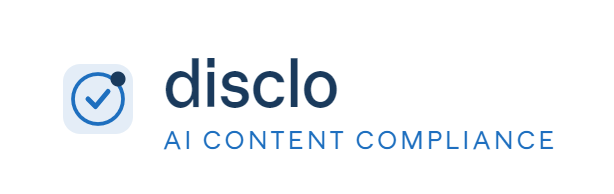
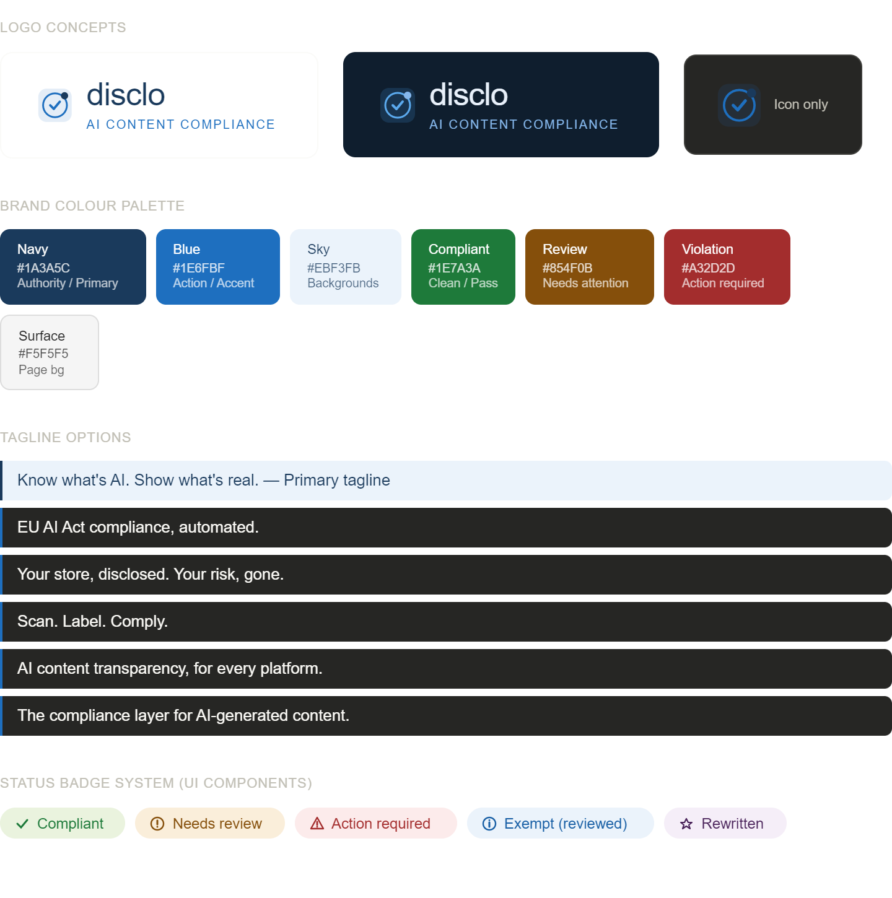

# Disclo Brand & SEO Master Documentation

## 1. Brand Identity & Visual System
### Logo & Core Visuals
* **Brand Name:** Disclo
* **Descriptor:** AI Content Compliance
* **Primary Tagline:** AI content transparency, for every platform.
* **Visual Icon:** Shield and checkmark hybrid symbol.

* **Brand Logo:** 

### Brand Color Palette
| Usage | Name | Hex Code | Purpose |
| :--- | :--- | :--- | :--- |
| **Primary** | Navy | `#1A3A5C` | Authority / Primary Brand |
| **Accent** | Blue | `#1E6FBF` | Action / UI Accents |
| **Background** | Sky | `#EBF3FB` | Light Section Backgrounds |
| **Page BG** | Surface | `#F5F5F5` | Main Page Background |
| **Status: Pass** | Compliant | `#1E7A3A` | Clean / Successful Scan |
| **Status: Warning** | Review | `#854F0B` | Needs Attention |
| **Status: Alert** | Violation | `#A32D2D` | Action Required |

### Status Badge System (UI Components)
* **Compliant:** Green badge with check icon.
* **Needs review:** Gold badge with exclamation icon.
* **Action required:** Red badge with warning triangle.
* **Exempt (reviewed):** Light blue badge with info icon.
* **Rewritten:** Purple badge with star icon.

### Tagline 
* AI content transparency, for every platform.
* The compliance layer for AI-generated content.
* Know what's AI. Show what's real.
* EU AI Act compliance, automated.
* Scan. Label. Comply.

### Brand Visual


---

## 2. Website SEO Strategy
### Metadata
* **Homepage Title:** `Disclo — EU AI Act Compliance Scanner for Ecommerce & Content`
* **Homepage Meta Description:** `Disclo scans your Shopify, WooCommerce, or WordPress store for AI-generated content and automates EU AI Act Article 50 compliance. Free scan. No coding required.`
* **Pricing Page Title:** `Disclo Pricing — EU AI Act Compliance from $0/month`
* **Blog / SEO Hub Title:** `EU AI Act Guide for Shopify Merchants | Disclo Blog`

### Canonical URL Structure
* `disclo.com/` — Homepage
* `disclo.com/pricing` — Pricing
* `disclo.com/platforms/shopify` — Shopify landing page
* `disclo.com/platforms/woocommerce` — WooCommerce landing page
* `disclo.com/platforms/wordpress` — WordPress landing page
* `disclo.com/eu-ai-act` — Regulatory explainer (SEO hub)
* `disclo.com/blog` — Content hub
* `disclo.com/api` — Developer / API docs
* `disclo.com/docs` — Help centre

### Robots.txt Directive
```text
User-agent: * Allow: / 
Disallow: /app/ 
Disallow: /api/private/ 
Sitemap: [https://disclo.com/sitemap.xml](https://disclo.com/sitemap.xml)
```

---

# Disclo SEO & Marketing Assets

## 3. Shopify App Store Listing
* **App name**: Disclo — AI Content Compliance
* **App tagline**: Scan, label, and audit AI-generated content. EU AI Act ready.
* **Short description**: Automatically detect AI-generated product descriptions and images across your store. Apply EU AI Act Article 50 disclosure labels in one click. Audit log included.
* **Full App Store description (opening paragraph)**: From August 2, 2026, the EU AI Act requires all merchants selling to EU consumers to label AI-generated product content — or face fines of up to €15 million. Disclo scans your entire Shopify store, identifies which product descriptions and images were AI-generated, and guides you through compliance in minutes — not weeks.
* **App Store categories**:
    * **Primary**: Store management › Legal & compliance
    * **Secondary**: Marketing › Content & SEO
* **Key benefits**:
    * One-click store scan — detect AI text and images across all products
    * EU AI Act Article 50 compliant — disclosure labels applied automatically
    * Editorial Exemption audit log — legal documentation built in
    * Monthly compliance health report — emailed to you automatically
    * Works on Shopify, WooCommerce, WordPress, BigCommerce, and more

---

## 4. Social / OG
* **og:title**: Disclo — EU AI Act Compliance for Ecommerce
* **og:description**: Scan your store for AI-generated content. Apply disclosure labels. Build your audit log. EU AI Act Article 50 compliance, automated.
* **og:image dimensions**: 1200 × 630px — Navy background (#1A3A5C), Disclo wordmark centred, tagline below: "AI content transparency, for every platform."
* **Twitter/X card type**: summary_large_image
* **LinkedIn company page tagline**: EU AI Act compliance infrastructure for ecommerce and content platforms.
* **X / Twitter bio**: Scan. Label. Comply. EU AI Act Article 50 compliance for Shopify, WooCommerce & WordPress stores. August 2, 2026 deadline approaching. 🔵
* **Product Hunt tagline**: EU AI Act compliance automation for online stores

---

## 5. Keyword Strategy
### Primary keywords — high intent, commercial
* EU AI Act compliance
* Shopify AI content scanner
* AI content disclosure app
* Article 50 EU AI Act
* AI generated content label
* EU AI Act ecommerce

### Long-tail keywords — blog / SEO hub targets
* does EU AI Act apply to Shopify merchants
* how to label AI product descriptions EU
* EU AI Act August 2026 deadline ecommerce
* AI generated images product compliance
* WooCommerce EU AI Act compliance plugin
* editorial exemption AI Act documentation
* FTC green claims substantiation ecommerce
* Shopify app store EU compliance 2026

### Content cluster map
| Page | Target keyword | Intent |
| :--- | :--- | :--- |
| disclo.com/eu-ai-act | EU AI Act compliance guide | Informational — top of funnel |
| disclo.com/eu-ai-act/article-50 | EU AI Act Article 50 explained | Informational — regulatory detail |
| disclo.com/eu-ai-act/ecommerce | EU AI Act ecommerce merchants | Commercial — high intent |
| disclo.com/platforms/shopify | Shopify EU AI Act compliance app | Commercial — bottom of funnel |
| disclo.com/platforms/woocommerce | WooCommerce AI compliance plugin | Commercial — bottom of funnel |
| disclo.com/editorial-exemption | EU AI Act editorial exemption guide | Informational — high value |
| disclo.com/blog/ftc-green-claims | FTC green claims ecommerce 2026 | Informational — secondary audience |

---

## 6. Technical Schema (Schema.org JSON-LD)

Homepage JSON-LD (paste into head head section)
```json
{
  "@context": "[https://schema.org](https://schema.org)",
  "@type": "SoftwareApplication",
  "name": "Disclo",
  "applicationCategory": "BusinessApplication",
  "applicationSubCategory": "ComplianceSoftware",
  "operatingSystem": "Web",
  "url": "[https://disclo.com](https://disclo.com)",
  "description": "Disclo scans ecommerce stores and content platforms for AI-generated content and automates EU AI Act Article 50 disclosure compliance.",
  "offers": [
    {"@type":"Offer","name":"Free","price":"0","priceCurrency":"USD"},
    {"@type":"Offer","name":"Basic","price":"29","priceCurrency":"USD"},
    {"@type":"Offer","name":"Pro","price":"99","priceCurrency":"USD"}
  ],
  "creator": {"@type":"Organization","name":"Disclo"},
  "featureList": [
    "AI content detection",
    "EU AI Act Article 50 compliance",
    "Editorial Exemption audit log",
    "Multi-platform support",
    "Monthly compliance reports"
  ]
}
```

FAQ Schema (add to /eu-ai-act page)
```json
{"@type":"FAQPage","mainEntity":[
 {"@type":"Question","name":"What is the EU AI Act Article 50?",
  "acceptedAnswer":{"@type":"Answer","text":"Article 50 of Regulation EU 2024/1689 requires businesses to label content that was significantly generated by AI when presenting it to consumers. Enforcement begins August 2, 2026."}},
 {"@type":"Question","name":"Does the EU AI Act apply to Shopify merchants?",
  "acceptedAnswer":{"@type":"Answer","text":"Yes. Any merchant using AI tools to create product descriptions or images that are shown to EU consumers is a deployer under the regulation, regardless of where the business is based."}}
]}
```